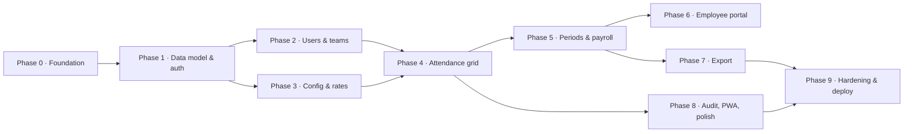

# Roadmap — شرق (Sharq)

Phased plan optimized for finishing fast, with **test coverage baked in**: tasks are tagged — `TEST` (tests for the named scope), `IMPL` (implementation), `E2E` (end-to-end flow), `CHORE` (tooling/infra). **Order changed 2026-10-19 (client decision, SPEC §20.1): from Phase 2 onward, implement first — each phase's `TEST` rows are written after its `IMPL` rows complete, then green together before the PR.** Every task references SPEC FR/EC ids and is sized for **one working session** (~half a day). Companion docs: [SPEC.md](SPEC.md) · [TESTING.md](TESTING.md).

**Global Definition of Done (applies to every phase):** all stage gates green (TESTING.md §12) · coverage gates met (§11) · traceability script passes (FR/EC ids covered) · no lint/line-count violations · phase flows pass in CI · **phase branch pushed, PR opened, merged by the client** (AGENTS.md Branch & PR workflow).

---

## Phase 0 — Monorepo, design system & test infrastructure

**Goal:** every guardrail and every test runner live before the first feature line; CI proves itself with a hello-test.

- [x] CHORE: Turborepo + pnpm workspaces + `catalog:`; packages `schemas/payroll/locales/ui/tsconfig/eslint-config` (SPEC §8.1)
- [x] CHORE: shared tsconfig bases + ESLint flat config with import zones, 150-line rule, complexity thresholds (SPEC §9.2/9.3)
- [x] CHORE: `tooling/check-line-count.mjs` + `.linecount-exemptions.json` + turbo `line-count` task (SPEC §9.2)
- [x] CHORE: bun:test runner wired in `packages/*` and `apps/api`; Vitest + jsdom + Testing Library in `apps/web` (TESTING §2.1)
- [x] CHORE: Playwright scaffold — chromium, desktop-RTL + mobile projects, trace viewer, axe addon (TESTING §2.1)
- [x] CHORE: CI pipeline skeleton running stages install→lint→line-count→typecheck→unit on every PR (TESTING §12)
- [x] TEST: hello unit test per runner (bun, vitest) proving red→green wiring — commit history shows red first
- [x] IMPL: Vite + React Router v7 framework mode (SPA) + fs-routes folder routing + `_app` layout + 404/error boundaries (SPEC §8.1, §11)
- [x] IMPL: Tailwind v4 tokens + shadcn init into `packages/ui`; RTL patch list applied (SPEC §14.1); self-hosted Arabic fonts (§14.2)
- [x] TEST: render tests for `EmptyState` / `LoadingState` / `ErrorState` incl. Arabic labels (SPEC §9.9)
- [x] IMPL: those three shared components green
- [x] IMPL: view transitions + `prefers-reduced-motion` handling (SPEC §14.3)
- [x] TEST: visual baseline of the RTL demo page (desktop + mobile) (TESTING §9)
- [x] CHORE: root scripts `dev/build/lint/typecheck/test/e2e/line-count/format` + dev-Postgres lifecycle `db:up/stop/reset` (SPEC §8.4; `db:generate/migrate/studio` + `seed` ride Phase 1's drizzle rows — client-approved 2026-10-18)

**Dependencies:** none. **Deliverables:** repo, CI, design system, docs committed.
**DoD:** `pnpm test` green across runners; CI enforces lint + line-count + unit; demo page renders RTL-correct with Arabic font; E2E hello spec runs in CI.

---

## Phase 1 — Data model & auth

**Goal:** schema with all history-safety constraints + working sessions + the layered module pattern proven.

- [x] TEST: registry unit tests — every SPEC §5.2 key has schema + seeded default + cross-field validator (FR-SET-01/08; TESTING §6.2)
- [x] IMPL: `@sharq/schemas` settings registry green
- [x] TEST: migration tests — exclusion constraints reject overlapping memberships & rates; uniq(user, date) enforced (EC-11, EC-17, EC-40)
- [x] IMPL: Drizzle schema + migrations for all SPEC §7 tables (incl. `version`, soft deletes, audit append-only role grants) + root `db:generate/migrate/studio` scripts
- [x] IMPL: seed module v1 (TESTING §15 personas subset: admin + supervisor + 5 employees + company rate) + root `seed` script
- [x] TEST: auth service units — password hashing/verify, lockout counter, session idle expiry math (FR-AUTH-01/03; EC-25)
- [x] IMPL: sessions table + cookie issue/revoke + idle timeout + lockout green
- [x] TEST: integration — login (username **and** phone), wrong password generic message, deactivated account, duplicate username/phone (FR-AUTH-01/04/08; EC-23/25)
- [x] IMPL: auth plugin (`login/logout/me/password`) + guard macros (`auth`/`role`/`teamScope`) green (SPEC §10.2)
- [x] TEST: contract tests for the 4 auth routes incl. error envelope codes (SPEC §10.4/10.6)
- [x] TEST: role-matrix table-driven test harness wired (mirrors SPEC §3) — starts failing for missing routes
- [x] IMPL: error envelope + Arabic error map wiring + audit helper green (SPEC §10.4, §15)
- [x] E2E: F-01 admin login happy path + wrong-credentials Arabic message (TESTING §9)

**Dependencies:** Phase 0. **Deliverables:** migrations, seed, auth module, guards, error system, role-matrix harness.
**DoD:** auth E2E green; role-matrix harness green for auth routes; api services coverage ≥ 85%; all Phase-1 EC ids traceable.

---

## Phase 2 — Admin: users & teams

**Goal:** full user/team/membership lifecycle with effective-dated memberships.

- [x] TEST: service units — membership range math (join mid-week, end membership, transfer closes+opens in one tx) (FR-ADM-03/04/05)
- [x] IMPL: users/teams/memberships services + team-scoped repositories green
- [x] TEST: integration — create user duplicate rejection (EC-23), reset revokes sessions (FR-AUTH-05), deactivate blocks login + revokes + keeps history (FR-AUTH-06, EC-12/25/58), supervisor replacement drops team access (FR-ADM-02, EC-09), overlap transfer → 409 (EC-08/11)
- [ ] IMPL: users/teams/memberships plugins green (SPEC §10.6 rows)
- [ ] TEST: contract tests for the new routes + role-matrix rows
- [ ] TEST: view render tests for users list/detail + teams list/detail (Arabic strings, empty/loading/error) (SPEC §11)
- [ ] IMPL: `/users`, `/teams` screens with `logic.ts` hooks green
- [ ] E2E: F-02 admin creates team + supervisor + members incl. mid-week join → sheet membership visible (TESTING §9)

**Dependencies:** Phase 1. **Deliverables:** admin screens + APIs.
**DoD:** membership lifecycle E2E green; EC-06..12, 23, 25, 58 covered by automated tests.

---

## Phase 3 — Configuration & rates

**Goal:** the entire §5 machinery — registry, resolver, rates, catalogs, impact preview, audit — fully unit-proven before any UI depends on it.

- [ ] TEST: resolver unit tests FIRST — the §5.3 cascade table + §5.4 examples 1–4 + boundary dates + membership-dated team default + seeded-default fallback (FR-SET-03; EC-40/41/43/55; TESTING §6.1)
- [ ] IMPL: `resolveRate` / `resolveSetting` in `@sharq/payroll` green
- [ ] TEST: period math units — generation, idempotency, transition rule (no gaps/overlaps), payday resolution + holiday shift (FR-PAY-01/08/09; EC-21/22, A10)
- [ ] IMPL: period generation functions green
- [ ] TEST: amount normalizer units — Arabic-Indic digits, `٫`, >2 decimals, zero, huge (EC-31..34)
- [ ] IMPL: normalizer in `@sharq/schemas` green
- [ ] TEST: integration — settings PATCH cross-field validation + version conflicts (EC-53), effective-date guard vs locked/paid (FR-SET-09, EC-42), minorUnitScale immutability (EC-52), impact endpoint counts, rate overlap 409, company-rate-without-successor block (EC-56), catalog deactivate-never-delete (EC-46)
- [ ] IMPL: settings/rates/reasons/statuses/holidays plugins + impact-preview service + settings audit green (SPEC §10.6)
- [ ] TEST: settings query contract — `SETTINGS_CHANGED` 409 carries fresh settings payload (EC-48)
- [ ] TEST: contract tests + role-matrix rows for all new routes
- [ ] TEST: view render tests for settings screens + ImpactPreviewDialog (SPEC §11)
- [ ] IMPL: `/settings/*` screens (rates timeline, entry, reasons, statuses, periods, policies, branding; calendar & security marked v1.1) green
- [ ] E2E: F-03 rate change mid-week with preview → prefill changes; F-04 bounds/quick-picks/catalog edits (TESTING §9)

**Dependencies:** Phase 1 (2 parallelizes). **Deliverables:** the whole dynamic-configuration system.
**DoD:** every §5.4 worked example green as a named unit test; resolver coverage ≥ 90%; admin can change any §5.2 key with preview + audit.

---

## Phase 4 — Attendance grid

**Goal:** the core product surface — desktop grid + mobile day mode + autosave + offline outbox.

- [ ] TEST: grid reducer units FIRST — full action matrix: pending overlay, selection, conflicts population, stale-settings delta, offline flips (SPEC §12; TESTING §6.3)
- [ ] IMPL: `grid.reducer.ts` green
- [ ] TEST: hook units — `useAttendanceGrid` returns view props per scenario; `useBulkSave` optimistic + rollback + invalidation map (TESTING §6.4)
- [ ] IMPL: `logic.ts`, `api.ts`, `queries.ts`, `mutations.ts` green (SPEC §9.4/9.6)
- [ ] TEST: integration — bulk endpoint: per-row results, idempotency replay, window enforcement, future block, bounds/mode/reason revalidation vs current settings, period-state guards (FR-ATT-01..08/11; EC-01..05, 17/18/19, 32..35; TESTING §7)
- [ ] IMPL: attendance plugin + service (snapshots!) green — entry stores `base_rate_snapshot_minor` + `is_override` (FR-ATT-10)
- [ ] TEST: deduction service units — limits, floor policy (FR-ATT-03; EC-13/14)
- [ ] IMPL: deductions plugin green
- [ ] TEST: view render tests — sheet, AmountCell (prefill + chips filtered to bounds), OverrideBadge, ReasonPopover (Arabic validation), BulkActionsBar, DayTabs (SPEC §12)
- [ ] IMPL: TanStack Table + Virtual grid — sticky header/first column, keyboard nav, ARIA grid semantics green (FR-GRID-01..07/11, §14.4)
- [ ] IMPL: autosave debounce + sync status machine + unsaved-changes guard (FR-GRID-08/12)
- [ ] IMPL: conflict dialog (both values, supervisor picks) + stale-settings banner flow (FR-GRID-09/10)
- [ ] IMPL: offline outbox (IndexedDB) + Background Sync replay (FR-ATT-09)
- [ ] E2E: F-05 desktop grid flow; F-06 mobile day mode; F-07 offline → reconnect → sync → forced conflict resolution (TESTING §9)

**Dependencies:** Phases 2 + 3. **Deliverables:** the grid feature end-to-end.
**DoD:** supervisor E2Es green incl. offline; grid a11y: keyboard-only pass + axe zero critical; 120-member team scrolls within perf budget (EC-59).

---

## Phase 5 — Payroll periods & calculation

**Goal:** deterministic money — generation, totals, snapshots, lifecycle, corrections.

- [ ] TEST: totals units FIRST — formula cases incl. adjustments, floor, non-carrying statuses (FR-PAY-02/03; TESTING §6.1)
- [ ] IMPL: totals functions in `@sharq/payroll` + wired into grid live preview green
- [ ] TEST: integration — generate idempotent; lock stores snapshot; writes into locked/paid → 409; unlock audited; policy flags respected on lock/mark-paid/unlock (FR-PAY-01/04/05/06/11; EC-18..20)
- [ ] IMPL: periods plugin + state machine green (SPEC §6.4)
- [ ] TEST: snapshot determinism — locked period recalculated after settings changes is byte-identical (FR-PAY-10; EC-50/51)
- [ ] IMPL: snapshot store/recalc green
- [ ] TEST: adjustment units + integration — signed amounts, mandatory reason, applied in next open period only (FR-PAY-07; EC-19)
- [ ] IMPL: adjustments plugin green
- [ ] TEST: view render tests for periods panel (state chips, actions per policy) (SPEC §11)
- [ ] IMPL: `/periods/:teamId` screen green
- [ ] E2E: F-08 lock → snapshot identical → mark paid (TESTING §9)

**Dependencies:** Phase 4. **Deliverables:** payroll engine + period lifecycle.
**DoD:** snapshot determinism E2E green; paid-week correction via adjustment E2E green; payroll coverage ≥ 90%.

---

## Phase 6 — Employee portal

**Goal:** the employee sees exactly what he earned.

- [ ] TEST: integration — portal endpoints derive user from session, ignore params, cross-user → 403 + audit (FR-PRT-04; EC-37)
- [ ] IMPL: portal plugin green
- [ ] TEST: integration — week summary totals match `@sharq/payroll`; day statuses محسوب/مش محسوب/مش متسجل; adjustments with reasons (FR-PRT-01..03; EC-04/05)
- [ ] TEST: view render tests — week card, day list, history tabs (Arabic strings per SPEC §2) (SPEC §11)
- [ ] IMPL: `/portal` screen green
- [ ] E2E: F-09 employee sees 2,400 − 100 = 2,300 EGP with per-day reasons + paid-state flip (TESTING §9)

**Dependencies:** Phase 5. **Deliverables:** employee portal. **DoD:** isolation tests green; portal E2E green. **← feature-complete MVP**

---

## Phase 7 — Export

**Goal:** Excel that always matches the screen.

- [ ] TEST: xlsx snapshot tests FIRST — fixture workbook hash + parsed assertions (RTL flag, header tokens, column order, money format, totals, filename pattern; long/mixed Arabic reasons) (FR-EXP-01..05; EC-29/30/36; TESTING §10)
- [ ] IMPL: ExcelJS export service + `/api/export` stream green (SPEC §13)
- [ ] TEST: integration — team/period selection, partial range → 422 Arabic guidance, supervisor limited to own team (FR-EXP-04; SPEC §3)
- [ ] IMPL: export buttons on grid/period screens green
- [ ] E2E: F-10 download → parse → totals == grid == portal == API (TESTING §9)

**Dependencies:** Phase 5 (grid button lands with Phase 4 UI). **Deliverables:** export feature.
**DoD:** parity E2E green; empty-period export green. **← smallest shippable MVP complete (Phases 0–7)**

---

## Phase 8 — Audit UI, PWA completion, dashboards & polish

**Goal:** operational depth + the offline/PWA experience the client chose + visual/a11y hardening.

- [ ] TEST: integration — audit viewer filters; append-only (no update/delete path) (FR-AUD-01..04)
- [ ] IMPL: `/audit` screen green
- [ ] TEST: PWA E2E — installability, offline shell, SW headers (TESTING §9)
- [ ] IMPL: service worker precache + runtime caching + offline banner UX (FR-ATT-09 completion; SPEC §17)
- [ ] TEST: dashboard integration — role-aware summaries + anomalies list (FR-DSH-01..03; EC-04)
- [ ] IMPL: dashboards green
- [ ] CHORE: apply client's final theme tokens when provided (A1) + dark-mode pass
- [ ] TEST: visual baselines for all SPEC §11 routes (desktop RTL + mobile) + axe scan per route — zero critical
- [ ] IMPL: fixes from visual/a11y sweep green
- [ ] TEST: rate-limit + lockout + security-headers integration tests (SPEC §15, §10.7)

**Dependencies:** Phase 7 (routes exist for scans). **Deliverables:** audit viewer, full PWA, dashboards, hardened UI.
**DoD:** PWA E2E green; axe zero critical on every route; visual baselines committed.

---

## Phase 9 — Testing completion & deployment

**Goal:** gates fully enforced, production live, restore proven.

- [ ] CHORE: enforce all coverage gates at final thresholds (TESTING §11) and fix the last gaps
- [ ] TEST: property-based payroll invariants (optional, fast-check): totals never negative with floor on; resolution always returns a value within seeded bounds (TESTING §2.1)
- [ ] TEST: full Playwright suite parallel in CI < 10 min; flaky sweep to zero quarantined (TESTING §13)
- [ ] CHORE: Dockerfiles — api (bun build → runtime) and web (node build → caddy) with health checks (SPEC §8.4)
- [ ] CHORE: Coolify stack — Traefik `/api` path routing on one domain, env vars, secrets (SPEC §8.4, §15)
- [ ] CHORE: migrations-on-deploy entrypoint + `/api/health` smoke script
- [ ] CHORE: nightly pg_dump to disk + offsite object storage; 30-day retention (SPEC §17)
- [ ] TEST: staging restore drill from backup — data + login verified (SPEC §17)
- [ ] TEST: deploy smoke — health, login, one write, one export on prod (scripted, human confirms report) (TESTING §14)
- [ ] CHORE: run the release checklist; tag v1.0

**Dependencies:** Phase 8. **Deliverables:** production.
**DoD:** all gates green on main; restore drill passes; smoke report signed off.

---

## v1.1 backlog (explicitly out of v1 — pull nothing earlier without updating SPEC §19)

- [ ] Custom attendance statuses UI beyond seeds (FR-SET-05 extras)
- [ ] Holiday calendar + payday-shift policy UI (FR-SET-06; logic already live from Phase 3)
- [ ] Team-level payday override (SPEC §5.2)
- [ ] Export template customization beyond column list (FR-SET-12 extras)
- [ ] Security knobs admin UI (SPEC §5.2 `security.*`)
- [ ] Self-service password reset (NG in v1)
- [ ] Employee trend sparkline (FR-DSH-04)

---

## Working agreements

1. **Test order (2026-10-19, client decision): from Phase 2, implementation comes first and each phase's tests are written after its implementation is complete.** The tests still cover everything TESTING §4.2 lists; **no PR merges with red/skipped tests** (unchanged).
2. Every PR lists the FR/EC ids it covers; the traceability gate backs this mechanically.
3. Bugs get a failing test first, referencing the EC id (or adding a new EC row to SPEC §16 in the same PR).
4. Phase DoDs are cumulative: earlier phases' gates keep running on every later PR.
5. Scope changes update SPEC.md first (single source of truth), then tests, then code.
6. Each phase ships on a `phase/<n>-<slug>` branch as one PR; the client reviews and merges — protocol in AGENTS.md (Branch & PR workflow).
