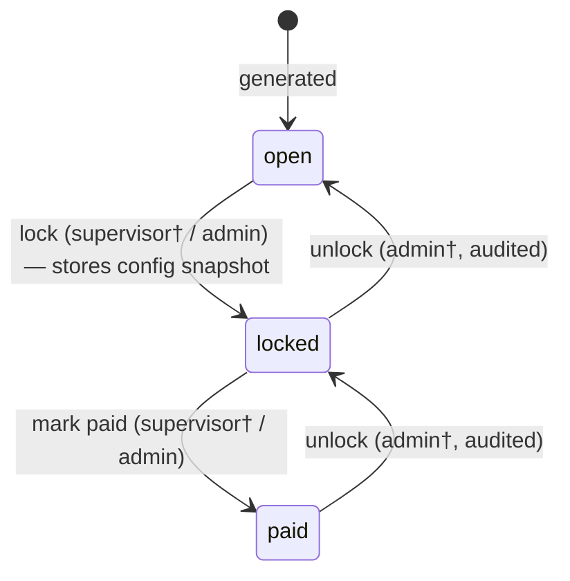
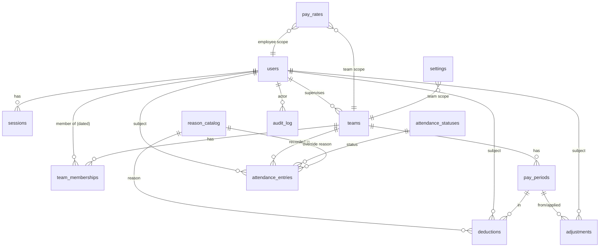

# شرق (Sharq) — Requirements Specification

**Payroll & attendance web app · Weekly pay (Thursday/Friday) · EGP · Egyptian-Arabic RTL UI**

Version 1.1 · Status: approved for implementation · Client decisions recorded in §20.1.
Companion documents: [TESTING.md](TESTING.md) (test strategy & TDD workflow) · [ROADMAP.md](ROADMAP.md) (phased plan).

> v1.1 changes over the reviewed draft: **TDD mandate added (§9.10)**, testing strategy expanded into TESTING.md, roadmap expanded into ROADMAP.md, goal G6 added (zero manual regression).

---

## 1. Vision, goals, non-goals

**Vision.** A focused web app that lets a company pay weekly wages correctly: supervisors record attendance and daily pay from their phones in minutes, employees see exactly what they earned and whether it was paid, and the admin changes rates/rules safely without ever corrupting a past week.

**Goals (v1)**

- G1: Daily attendance + dynamic daily-pay entry with per-day effective-rate prefill, bounds, quick-picks, and mandatory reasons on overrides/deductions.
- G2: Deterministic weekly payroll per employee with period lifecycle (open → locked → paid) and full history safety (snapshots, effective dating, audit).
- G3: 100% admin-editable, effective-dated, audited configuration — zero business values in code (§5 test).
- G4: Egyptian-Arabic RTL UI (colloquial, e.g. «مرتبك الأسبوع ده»), mobile-first for supervisors, Excel-like grid on desktop, PWA with offline entry and background sync.
- G5: Excel export that always matches on-screen totals.
- G6: **Zero-manual-regression quality system** — every acceptance criterion and every edge case is an automated test; TDD is the default working mode (§9.10, TESTING.md).

**Non-goals (explicitly out of scope for v1)**

- NG1: Public self-signup; accounts are created by admin only.
- NG2: Banking integrations, payslips PDF, e-invoicing, taxes/Zakat rules, loans/advances management (only manual adjustments).
- NG3: Biometric/geo attendance capture; only manual entry by supervisor/admin.
- NG4: Multi-currency payroll (EGP only; currency code is a label), monthly/bi-weekly periods (schema-ready, not generated).
- NG5: Configurable roles/permissions (fixed 3-role matrix, §3), generic workflow engine, notifications (SMS/email push) beyond in-app toasts.
- NG6: Native mobile apps (PWA covers mobile), multi-company tenancy.
- NG7: Real-time chat, file management, HR profiles (documents, leave balances).

**v1.1 candidates** (built only after v1 ships): custom attendance statuses UI (schema ships in v1), holiday calendar UI + payday-shift policy UI, team-level payday override UI, export template customization UI, security knobs UI (§5.2), self-service password reset.

---

## 2. Glossary & Egyptian-Arabic UI terms

| Term | Definition |
|---|---|
| **Pay period (فترة المرتب)** | A stored row with `start_date`/`end_date` (seeded Saturday→Friday) whose days roll up into one weekly total per employee. |
| **Payday (يوم الصرف)** | The weekday the week's wages are handed out (seeded Friday; Thursday supported). A property of the period; never changes day membership. |
| **Daily rate / base rate (اليومية / السعر الأساسي)** | Effective-dated amount resolved employee → team → company → seeded default at a given date. |
| **Effective dating (التأريخ الفعّال)** | Every rate/dated setting row has `valid_from`/`valid_to`; changes append new rows and never overwrite history. |
| **Override (تعديل)** | An entry whose amount ≠ the base-rate snapshot captured at entry time. Requires a reason when the toggle is on. |
| **Deduction (خصم)** | A separate negative amount with a mandatory reason (e.g. lateness). |
| **Adjustment (تسوية)** | A signed correction applied in the *next open* period for a previously paid week. |
| **Snapshot (نسخة محفوظة)** | Value frozen at write time: entry base-rate snapshot; locked-period config snapshot. |
| **Status carries pay (يوم بيتم حسابه)** | Attendance status flag; only carrying statuses sum into the total («حضور» yes, «غياب» no, «إجازة بعذر» admin's choice). |
| **Minor units (القروش)** | All money stored as integers (EGP ×100, scale 2). Floats are forbidden. |
| **Sheet (الشيت)** | The weekly grid: rows = employees, columns = days + total. |

**UI string table (use exactly, everywhere):**

| Concept | UI string (Egyptian Arabic) |
|---|---|
| Salary / your week's salary | المرتب / مرتبك الأسبوع ده |
| Daily rate | اليومية |
| Base rate | السعر الأساسي |
| Attendance | الحضور |
| Present / Absent | حضور / غياب |
| Excused leave | إجازة بعذر |
| Deduction | خصم |
| Override | تعديل |
| Reason | السبب |
| Week / pay period | الأسبوع / أسبوع المرتب |
| Team | الفريق |
| Supervisor | المشرف |
| Admin | مدير النظام |
| Employee | الموظف |
| Paid / not paid yet | متصرف / لسه متصرفش |
| Open / Locked | مفتوح / مقفول |
| Weekly total | إجمالي الأسبوع |
| Quick-pick amounts | مبالغ جاهزة |
| Save / Saving / Saved | حفظ / بيحفظ… / اتحفظ ✓ |
| Sync pending (offline) | لسه بيرفع البيانات… |
| Export to Excel | صدّر إكسل |
| Counted day / not counted / not recorded | محسوب / مش محسوب / مش متسجل |
| Settings changed (server) | الإعدادات اتحدثت من مدير النظام |
| Reason required | لازم تكتب السبب |

---

## 3. Roles & permission matrix

Three roles fixed in code (`users.role` enum): `employee`, `supervisor`, `admin`. **Fixed in code, not configurable — justification (YAGNI):** the company has exactly one operating model (admin owns config, supervisor owns a team, employee reads his own data); a permission editor adds tables, UI, audit surface and defect risk, while every conceivable change for a 3-role system is a one-line code change reviewed in git. (Restated as assumption in §20.)

Scope legend: **own** = own data only · **own team** = teams the user supervises · **all** = any team/any user.

| Action | Employee | Supervisor | Admin | FR |
|---|---|---|---|---|
| Log in / log out / change own password | ✓ | ✓ | ✓ | FR-AUTH-01/02/07 |
| View own portal (days, totals, payday, paid state) | ✓ own | ✓ own | ✓ own | FR-PRT-01..04 |
| View team sheet + totals | — | ✓ own team | ✓ all | FR-GRID-01 |
| Record/edit attendance entry (within window) | — | ✓ own team | ✓ all | FR-ATT-01/04 |
| Record/edit deduction (within window) | — | ✓ own team | ✓ all | FR-ATT-03 |
| Delete own-team entry (within window) | — | ✓ own team | ✓ all | FR-ATT-06 |
| Bulk save grid changes | — | ✓ own team | ✓ all | FR-ATT-08 |
| See override marker & enter override reason | — | ✓ own team | ✓ all | FR-ATT-02, FR-GRID-04/05 |
| Lock period | — | ✓ own team (if `policy.canSupervisorLock`) | ✓ all | FR-PAY-04 |
| Mark period paid | — | ✓ own team (if `policy.canSupervisorMarkPaid`) | ✓ all | FR-PAY-05 |
| Unlock locked/paid period | — | — | ✓ (if `policy.canAdminUnlockPaid`; audited) | FR-PAY-06 |
| Create adjustment for a paid week | — | — | ✓ | FR-PAY-07 |
| Export sheet to Excel | — | ✓ own team | ✓ all | FR-EXP-01 |
| Create/edit/deactivate users, reset passwords | — | — | ✓ | FR-AUTH-04..06 |
| Create teams, assign supervisor, manage memberships | — | — | ✓ | FR-ADM-01..05 |
| Edit settings registry, rates, quick-picks & bounds | — | — | ✓ | FR-SET-01..12 |
| Manage reason catalog / attendance statuses / holidays | — | — | ✓ | FR-SET-04/05/06 |
| Change week start / payday | — | — | ✓ | FR-SET-07 |
| View audit log | — | — | ✓ | FR-AUD-03 |
| View dashboards | — (own summary only) | ✓ own team | ✓ all | FR-DSH-01..04 |

Server-side enforcement is mandatory (§10, §15): route guards **and** team-scoped repository methods **and** service-level ownership checks (defense in depth). The full matrix is executable as a table-driven test (TESTING.md §7).

---

## 4. Functional requirements

Priorities: **MVP** (smallest shippable set, ROADMAP.md), **v1.1**, **later**. Acceptance criteria in Given/When/Then form; **each criterion maps 1:1 to an automated test** (TESTING.md §5).

### 4.1 Auth & accounts

- **FR-AUTH-01 (MVP) Login.** Given a valid (username **or** phone) + password, when submitted, then a session row is created, an httpOnly cookie is set, and the user lands on his role home (admin → dashboard, supervisor → team sheet, employee → portal). Wrong credentials → generic Arabic message «البيانات مش صح» + rate-limit counter.
- **FR-AUTH-02 (MVP) Logout.** Given a logged-in user, when he logs out (any device), then the session row is revoked, the cookie cleared, and all other tabs of that session get 401 on next call.
- **FR-AUTH-03 (MVP) Session expiry.** Given an idle session older than `security.sessionIdleMinutes`, when any request arrives, then 401 is returned and the client shows a re-login dialog that preserves unsaved grid edits (EC-39).
- **FR-AUTH-04 (MVP) Create user.** Given an admin, when he creates a user (role, username, phone, display name, temp password), then the user can log in; duplicate username/phone is rejected with a field-level Arabic message (EC-23).
- **FR-AUTH-05 (MVP) Reset password.** Given an admin, when he resets a user's password, then the old sessions are revoked and a temporary password is set (admin shares out-of-band; `must_change_password` forces a change on next login).
- **FR-AUTH-06 (MVP) Deactivate/reactivate.** Given a user with payroll history, when an admin deactivates him, then login is blocked, existing sessions revoked, all history retained (soft delete only); reactivation restores login (EC-12).
- **FR-AUTH-07 (MVP) Change own password.** Given any logged-in user, when he changes his password (current password required), then other sessions stay valid and the change is audited.
- **FR-AUTH-08 (MVP) Disabled account guard.** Given a deactivated account, when login is attempted, then a generic failure is returned and the attempt is written to the audit log (EC-25).

### 4.2 Admin — users & teams

- **FR-ADM-01 (MVP) Create team.** Given an admin, when he creates a team (Arabic name + supervisor), then the team appears with zero members and an open period can be generated for it.
- **FR-ADM-02 (MVP) Replace supervisor.** Given a team, when the supervisor is replaced, then the old supervisor immediately loses team-scoped access (if not deactivated he keeps personal portal access), and all history shows who recorded what (EC-09).
- **FR-ADM-03 (MVP) Add member (effective-dated).** Given a team, when an employee is added with `valid_from = D`, then he appears in the sheet from D only, and days before D are never shown/editable for him (EC-06).
- **FR-ADM-04 (MVP) End membership.** Given a member, when membership is ended at date E, then he disappears from the sheet after E; his entries and totals remain intact forever (EC-07).
- **FR-ADM-05 (MVP) Transfer member.** Given an employee in team A, when an admin transfers him to team B from date D, then the membership range in A closes (D−1) and opens in B (D) in one transaction; overlapping memberships for one employee are rejected by the database (EC-08/EC-11); rate resolution follows membership dates (§5.3).
- **FR-ADM-06 (MVP) List/search users** by name/phone/role/team with pagination; shows active state.
- **FR-ADM-07 (MVP) User profile** shows membership history and payroll history summary (read-only).

### 4.3 Settings & configuration (implements §5)

- **FR-SET-01 (MVP) Settings browser.** Given an admin, when he opens Settings, then every registry key from §5.2 is visible grouped by area, with current resolved value, scope badge, last change and a link to its audit trail.
- **FR-SET-02 (MVP) Edit scalar setting.** Given an admin, when he edits a registry value, then (1) cross-field validation runs (min ≤ max, quick-picks within bounds), (2) an impact preview dialog shows consequences («التغيير هيأثر على N موظفين يبدأ من DATE»), (3) on confirm the change is effective-dated/audited per its §5.2 row, and (4) past data is never touched.
- **FR-SET-03 (MVP) Manage pay rates.** Admin CRUDs company/team/employee rates with `valid_from`; forbid `valid_from` inside a locked/paid period (EC-42); forbid closing a company rate without an active successor (EC-56); every change audited.
- **FR-SET-04 (MVP) Reason catalog.** Admin manages override-reason and deduction-reason items (Arabic name, optional default amount for deductions, active flag). Deactivation only — never delete when used (EC-46).
- **FR-SET-05 (MVP) Attendance statuses.** «حضور»/«غياب» are system-protected (undeletable, `carries_pay` immutable). Admin may add statuses (e.g. «إجازة بعذر») with a carries-pay flag, and deactivate custom ones.
- **FR-SET-06 (v1.1) Holidays UI.** Holiday table + payday-shift policy UI. Schema, seeds and resolution logic ship in v1 (used by FR-PAY-08) so v1.1 adds UI only.
- **FR-SET-07 (MVP) Week start & payday.** Admin edits both; the impact preview shows the next period's boundaries; existing periods are never regenerated retroactively (FR-PAY-09 transition rule).
- **FR-SET-08 (MVP) Cross-field validation** as above; violations block save with Arabic messages.
- **FR-SET-09 (MVP) Effective-date guard.** Any dated change with `valid_from` inside a locked/paid period is rejected server-side (409 `PERIOD_LOCKED`/`PERIOD_PAID`).
- **FR-SET-10 (MVP) Audit of settings.** Every settings/rate/catalog change writes old value, new value, actor, note (§15) — covered by FR-AUD-01.
- **FR-SET-11 (MVP) Entry amounts config.** min/max bounds, quick-picks list, entry mode (free vs quick-picks-only) editable; seeded quick-picks 400/600/800 EGP exist only as seed rows, never code constants.
- **FR-SET-12 (MVP) Branding & export config.** company name, logo, export header text, export columns, filename pattern editable with live preview of the resulting header/filename.

### 4.4 Attendance & pay entry

- **FR-ATT-01 (MVP) Record a day.** Given an open day for a team member, when the supervisor opens day entry, then each employee row shows status (seeded «حضور») and the amount prefilled with that employee's **effective rate for that day**; saving persists status + amount.
- **FR-ATT-02 (MVP) Override + reason.** Given the entered amount ≠ the base-rate snapshot, when saving, then a reason is required (catalog pick and/or free text per config) unless `attendance.reason.requiredOnOverride` is off; equality requires none (EC-15).
- **FR-ATT-03 (MVP) Deduction.** Given any day, when the supervisor adds a deduction, then amount + reason are mandatory; limits from §5.2 applied (EC-13/14).
- **FR-ATT-04 (MVP) Edit window.** Edits allowed only within `attendance.editWindow.daysBack` days (Africa/Cairo date math); older → 409 `EDIT_WINDOW_CLOSED` with Arabic message (EC-01/02).
- **FR-ATT-05 (MVP) Future blocked.** Future dates (per `blockFutureDays`) are read-only in UI and rejected server-side (EC-03).
- **FR-ATT-06 (MVP) Delete entry.** Soft-delete within the window only; audited with old values.
- **FR-ATT-07 (MVP) Server revalidation.** Every write is re-validated server-side against **current resolved settings** (bounds, entry mode, reason rules, edit window, period state, status carries-pay) — client checks are UX only.
- **FR-ATT-08 (MVP) Bulk save.** `POST /attendance/bulk` applies N cell changes in one request with per-row results and an idempotency key (EC-17).
- **FR-ATT-09 (v1) Offline queue & sync.** Given no connectivity, when a supervisor saves cells, then changes persist in IndexedDB, show «لسه بيرفع البيانات…», and replay automatically (Background Sync + on focus) after reconnect; per-row conflicts surface per FR-GRID-09 (EC-26/27).
- **FR-ATT-10 (MVP) Base-rate snapshot.** The resolved base rate at save time is stored on the entry; later rate changes never flip the override flag (EC-43).
- **FR-ATT-11 (MVP) Bounds & mode.** Amount must be an integer in minor units within bounds; quick-picks-only mode rejects non-listed amounts (EC-32..35).
- **FR-ATT-12 (MVP) Day-mode mobile entry.** On < `lg` screens the grid becomes a day-by-day card list (pick day → employees stacked vertically) with identical validation.

### 4.5 Excel-like grid

- **FR-GRID-01 (MVP)** Render sheet: rows = active members (per membership dates in the period), columns = period days + «إجمالي الأسبوع» (live-computed client-side by `@sharq/payroll`).
- **FR-GRID-02 (MVP)** Inline cell editing + keyboard navigation (arrows/Enter/Esc/Tab) with full ARIA grid semantics (§14.4).
- **FR-GRID-03 (MVP)** Quick-pick chips under the active amount cell (or in the mobile amount stepper), filtered to current bounds.
- **FR-GRID-04 (MVP)** Override marker (colored dot + «تعديل» icon) on any cell whose amount ≠ its snapshotted base rate.
- **FR-GRID-05 (MVP)** Reason popover for overrides/deductions: catalog dropdown + free-text field per config, Arabic validation messages.
- **FR-GRID-06 (MVP)** Bulk actions on selected cells/rows: set one amount for all selected, mark all present for a day.
- **FR-GRID-07 (MVP)** Sticky header row and sticky first column (employee name) in both RTL scroll directions.
- **FR-GRID-08 (MVP)** **Autosave** (recommended & adopted): per-cell debounce 800 ms via the bulk endpoint; visible state machine «بيحفظ… / اتحفظ ✓ / فيه مشكلة» + retry; explicit «حفظ» button kept as an accessible fallback.
- **FR-GRID-09 (MVP)** Conflict handling: on 409 `CONFLICT_VERSION`, the cell is re-based on the fresh server value, both values shown, supervisor picks; never silent last-write-wins (EC-16).
- **FR-GRID-10 (MVP)** Stale-settings handling: on 409 `SETTINGS_CHANGED` the fresh settings are applied, pending edits re-validated in place, a banner «الإعدادات اتحدثت من مدير النظام» explains what changed (EC-48/49).
- **FR-GRID-11 (MVP)** Row virtualization beyond 30 rows; 150 employees × 7 days must scroll at 60 fps (§17).
- **FR-GRID-12 (MVP)** Unsaved-changes guard on navigation/route unload («عندك تغييرات لسه متحفظتش»).
- **FR-GRID-13 (MVP)** Mobile day view (FR-ATT-12) with the same reducer, actions and endpoints.

### 4.6 Payroll calculation & pay periods

- **FR-PAY-01 (MVP) Period generation.** Periods are stored rows generated forward from config (`weekStartDay`, `payday`); generation is idempotent per team and never mutates existing rows.
- **FR-PAY-02 (MVP) Weekly total.** `total = Σ amounts (entries whose status carries pay, in period) − Σ deductions + Σ adjustments applied in period`, floor-at-zero per policy; computed by `@sharq/payroll` on both server (truth) and web (live preview).
- **FR-PAY-03 (MVP) Floor policy** per `deduction.floorAtZero`.
- **FR-PAY-04 (MVP) Lock.** Locking stores the resolved **configuration snapshot** (boundaries, payday, holiday decisions, policy flags, formula version) and freezes the period to writes.
- **FR-PAY-05 (MVP) Mark paid** (per policy flags) records `paid_by/at`; portal flips to «متصرف».
- **FR-PAY-06 (MVP) Unlock** (admin, per flag, audited) returns the period to `locked`/`open` per its previous state.
- **FR-PAY-07 (MVP) Corrections after paid.** Editing a paid week is forbidden; corrections are signed **adjustments** applied in the next open period with a mandatory reason; portal shows «تسوية من أسبوع سابق».
- **FR-PAY-08 (MVP logic / v1.1 UI) Payday holiday shift** per `calendar.paydayHolidayPolicy` (earlier/later/keep), computed at generation/lock from the holiday table.
- **FR-PAY-09 (MVP) Transition safety.** Changing `weekStartDay`/`payday` never regenerates past periods; the next generated period starts exactly at `last_period.end_date + 1 day` (no gaps, no overlaps).
- **FR-PAY-10 (MVP) Snapshot determinism.** Recalculating a locked period uses its snapshot, not current settings — byte-identical totals.
- **FR-PAY-11 (MVP) State guards.** All attendance writes into `locked`/`paid` periods are rejected (409) with Arabic messages (EC-18/19).

### 4.7 Employee portal

- **FR-PRT-01 (MVP) Week summary**: «مرتبك الأسبوع ده» card — total (formatted per digit style), payday date, «متصرف/لسه متصرفش», entry completeness.
- **FR-PRT-02 (MVP) Per-day list**: status (محسوب/مش محسوب/مش متسجل), amount, override reason, deductions with reasons.
- **FR-PRT-03 (MVP) History**: past weeks with totals and paid state; adjustments listed with reasons.
- **FR-PRT-04 (MVP) Data isolation**: all portal data is scoped to the session user server-side; any attempt to read another user's data → 403 + audit (EC-37).

### 4.8 Export

- **FR-EXP-01 (MVP)** Export a team×period sheet to `.xlsx` from server; identical totals to screen (FR-EXP parity test).
- **FR-EXP-02 (MVP)** Columns per `export.columns` config; RTL sheet (`rightToLeft: true`); Arabic headers; totals row per employee and grand total row; money formatted with `#,##0.00` and currency label.
- **FR-EXP-03 (MVP)** Filename from `export.filenamePattern` tokens.
- **FR-EXP-04 (MVP)** Team + date-range selection (range must resolve to whole period(s); partial ranges are rejected with a helpful message).
- **FR-EXP-05 (MVP)** Exporting an empty period yields a valid file with zeros (EC-36).

### 4.9 Audit log

- **FR-AUD-01 (MVP)** Every config/rate/catalog change logs actor, timestamp, entity, old JSON, new JSON, optional note.
- **FR-AUD-02 (MVP)** Every attendance/deduction/period-state/adjustment action logs actor, entity, old/new, reason.
- **FR-AUD-03 (MVP)** Admin-only filterable viewer (actor, entity type, date range, team).
- **FR-AUD-04 (MVP)** Append-only: no API path updates/deletes audit rows; DB role lacks UPDATE/DELETE on the table.

### 4.10 Dashboard / summary

- **FR-DSH-01 (MVP) Admin dashboard**: teams with current week status (open/locked/paid), headcount, total payroll this week, unpaid periods count, link to each.
- **FR-DSH-02 (MVP) Supervisor dashboard**: own team's week progress (recorded days count vs expected), total, state, quick links to today's entry.
- **FR-DSH-03 (MVP) Anomalies list**: members with unrecorded days in the open period (drives «السجل ناقص»).
- **FR-DSH-04 (v1.1) Employee mini-summary** on portal home (latest week + trend sparkline).

---

## 5. Dynamic configuration & settings (binding)

### 5.1 Architecture (anti-EAV)

- **Typed settings registry** in `@sharq/schemas`: for each key — TypeBox schema, seeded default, scope, effective-dating mode, edit permission, impact-preview descriptor. Scalar settings live in the `settings` table (typed JSONB validated by the registry schema).
- **Dedicated tables** for multi-row data: `pay_rates`, `reason_catalog`, `attendance_statuses`, `holidays`.
- **One resolver** (`@sharq/payroll/config`): pure functions `resolveSetting(key, scopeChain, date)` and `resolveRate(scopeChain, date)` shared by API and web (DRY; schema parity is compile-time because both sides import the same functions).
- **Everything not listed in §5.2 stays in code** with justification (§5.7).

### 5.2 Settings catalog (every row effective-dated or immediate as noted; "affects past data" is always **No**)

Seeds are **seed rows**, never code constants. Money seeds shown in EGP for readability; stored in minor units.

| Key | Meaning | Type & validation | Scope | Seeded default | Effective-dated? | Edits | Past data |
|---|---|---|---|---|---|---|---|
| `payroll.weekStartDay` | First day of the pay week | enum `sat..fri` | company | Saturday | Immediate (future periods; FR-PAY-09) | Admin | No |
| `payroll.payday` | Payday weekday | enum `sun..fri` | company (+ optional team override v1.1) | Friday | Immediate (future periods) | Admin | No |
| `pay_rates` (table) | Daily base rate by scope | int minor > 0; `valid_from ≤ valid_to`; no overlap per scope target | company / team / employee | company 400 EGP | **Yes** (`valid_from/valid_to` + exclusion constraint) | Admin | No |
| `attendance.amount.minMinor` | Minimum amount per day | int minor ≥ 0 | company | 0 | Immediate | Admin | No (snapshots) |
| `attendance.amount.maxMinor` | Maximum amount per day | int minor ≥ min | company | 5,000 EGP | Immediate | Admin | No |
| `attendance.quickPicks` | Quick-pick chips | array int minor, each within bounds, ≤ 8 items | company | [400, 600, 800] EGP | Immediate | Admin | No |
| `attendance.entryMode` | Entry mode | enum `free` \| `quick_picks_only` | company | `free` | Immediate | Admin | No |
| `attendance.reason.requiredOnOverride` | Reason rule | boolean | company | true | Immediate | Admin | No |
| `attendance.reason.requiredOnDeduction` | Reason rule (client rule: required) | boolean | company | true | Immediate | Admin | No |
| `attendance.reason.minLength` | Min reason length | int 2..20 chars | company | 3 | Immediate | Admin | No |
| `attendance.reason.allowFreeText` | Free text beside catalog | boolean | company | true | Immediate | Admin | No |
| `reason_catalog` (table) | Override + deduction reasons | `{kind, name_ar ≤100, default_amount_minor?, is_active}`; deduction default ≤ deduction max | company | 4 seed rows (§5.6) | Immediate (rows versioned) | Admin | No |
| `attendance_statuses` (table) | Statuses | `{code, name_ar, carries_pay, is_active}`; `present`/`absent` system-protected | company | حضور(pay) / غياب(no pay) | Immediate | Admin | No |
| `attendance.editWindow.daysBack` | Days back editable | int 0..90 | company | 7 | Immediate | Admin | No |
| `attendance.editWindow.blockFutureDays` | Block future days | boolean | company | true | Immediate | Admin | No |
| `attendance.editWindow.autoLockDaysAfterPeriodEnd` | Auto-lock after N days | int 1..30 \| null (off) | company | null (off) | Immediate | Admin | No |
| `policy.canSupervisorLock` | Who may lock | boolean | company | true | Immediate | Admin | No |
| `policy.canSupervisorMarkPaid` | Who may mark paid | boolean | company | false | Immediate | Admin | No |
| `policy.canAdminUnlockPaid` | Who may unlock | boolean | company | true | Immediate | Admin | No |
| `deduction.allowExceedDayPay` | Deduction vs day's pay | boolean | company | false | Immediate | Admin | No |
| `deduction.allowExceedWeeklyTotal` | Deduction vs weekly total | boolean | company | false | Immediate | Admin | No |
| `deduction.floorAtZero` | Floor totals at 0 | boolean | company | true | Immediate | Admin | No |
| `deduction.maxPerEntryMinor` | Max deduction per entry | int minor \| null | company | null | Immediate | Admin | No |
| `currency.code` | Currency label | ISO 4217 string | company | `EGP` | Immediate | Admin | No (label only) |
| `currency.minorUnitScale` | Minor-unit scale | int; **immutable once attendance exists** (guard, EC-52) | company | 2 | Immediate | Admin | No (hard guard) |
| `format.digitStyle` | Digit rendering | enum `western` \| `arabic_indic` | company | `western` | Immediate | Admin | No (display only) |
| `branding.companyName` | Name in UI/exports | string ≤ 60 | company | «شرق» | Immediate | Admin | No |
| `branding.logoUrl` | Logo | URL \| null | company | null | Immediate | Admin | No |
| `export.headerText` | Export header | string ≤ 200, tokens allowed | company | «شرق — كشف مرتبات {team} — أسبوع {period}» | Immediate | Admin | No |
| `export.columns` | Export column list | ordered subset of allowed set | company | name, days×7, deductions, adjustments, total | Immediate | Admin | No |
| `export.filenamePattern` | Filename pattern | string with tokens `{team},{from},{to}` | company | `sharq-{team}-{from}-{to}.xlsx` | Immediate | Admin | No |
| `calendar.weeklyOffDays` | Weekly off days | array weekday | company | [Friday] | Immediate (future sheets) | Admin | No |
| `calendar.paydayHolidayPolicy` | Holiday payday shift | enum `earlier`\|`later`\|`keep` | company | `earlier` | Immediate (open periods; snapshot on lock) | Admin | No (locked snapshots) |
| `holidays` (table) | Public holidays | `{date unique, name_ar}` | company | empty | Immediate (open periods) | Admin | No (locked snapshots) |
| `security.sessionIdleMinutes` | Idle timeout | int 5..1440 | company | 240 | Immediate | Admin | No |
| `security.minPasswordLength` | Password length | int 8..64 | company | 8 | Immediate | Admin | No |

`security.*` UI ships in **v1.1**; keys, seeds and enforcement land in v1.

### 5.3 Scope resolution & worked example

Order (first hit wins): **employee → team (via membership at the effective date) → company → seeded default from the registry**. Applies to `pay_rates` and (where scoped) registry keys.

*Worked example (rates):* Company rate row 400 EGP (since Jan 1). Team «الصيانة» row 500 EGP valid Oct 1→Oct 9. Employee «سيد» has a personal row 600 EGP valid from **Oct 10**.

| Date | Chain evaluated | Resolved |
|---|---|---|
| Sep 30 | سيد: none → team: none yet (starts Oct 1) → company 400 | **400** |
| Oct 5 | سيد: none → team 500 (covers Oct 5) | **500** |
| Oct 12 | سيد 600 (covers Oct 12) | **600** |
| Oct 20 | سيد 600 | **600** |

Team resolution for «سيد» always uses the team he belonged to **on that date** (membership ranges), so a mid-week transfer changes the team default from the transfer date only.

### 5.4 Effective dating — worked examples

Stored as `valid_from`/`valid_to` (null = open) with a Postgres **exclusion constraint** (`btree_gist`) per scope target: two rows of the same scope may never cover the same date. (This is the mechanism the client asked about: the database itself rejects overlapping validity, so "resolve the rate at date D" can only ever match one row.)

1. **Mid-week change:** On Wed Oct 15, admin sets سيد's rate to 700 EGP from **Thu Oct 16**. Rows: [.., Oct 15] = 600, [Oct 16, ) = 700. Thursday's prefill = 700; Mon–Wed entries keep their 600 snapshots.
2. **Backdated into an OPEN period:** Admin sets 650 EGP from Tue Oct 14 (period Oct 11–17, open). Allowed **with impact preview** («هيأثر على 1 موظف من ١٤ أكتوبر؛ السجلات القديمة مش هتتغير»). The existing Tue entry keeps its snapshot and override flag; **future prefills** use 650 (EC-41).
3. **Backdated into a LOCKED/PAID period:** `valid_from` Oct 8 with period Oct 4–10 locked → rejected (FR-SET-09) with «مش ممكن تبدأ التاريخ ده — الأسبوع مقفول» (EC-42).
4. **Set for next week:** `valid_from` = next period's start (Sat Oct 18) → accepted; current week unchanged.

### 5.5 Snapshots & change safety

1. **Entry snapshot:** `attendance_entries.base_rate_snapshot_minor` + `is_override` frozen at save (EC-43).
2. **Period snapshot:** on lock, `pay_periods.config_snapshot` stores resolved payday, boundaries, holiday shifts, policy flags, formula version (FR-PAY-04/10).
3. **Reason snapshot:** entries/deductions store `reason_catalog_id` **and** `reason_text` (the catalog name copied), so deactivating a catalog item never changes how history reads (EC-46).
4. **Catalog lifecycle:** create → edit (name/default amount; audited) → deactivate (if referenced, ever) — **never delete**.
5. **Audit:** every change → `audit_log` (who/when/old/new/note).
6. **Change safety:** cross-field validation (§5.2), impact preview dialog before save (counts affected employees + start date; for bounds: count of *future* entries that would violate — past entries are exempt because they are snapshotted), effective-date guard vs locked/paid periods, and the immutability guard on `currency.minorUnitScale`. Optimistic `version` on settings rows prevents silent dual-admin overwrites (EC-53: second admin gets 409 + fresh value).

### 5.6 Seeds (demo data, never code constants)

Company rate 400 EGP; quick-picks 400/600/800; reason catalog: overrides — «شغل إضافي», «مهمة خارجية»; deductions — «تأخير» (default 50 EGP), «غياب نص يوم» (default 200 EGP); statuses «حضور»/«غياب»; holidays: none (admin adds).

### 5.7 Deliberately NOT configurable (with reasons)

| Item | Reason |
|---|---|
| Roles & permission matrix | One operating model; 3 fixed roles (YAGNI) |
| Payroll formula structure | The formula is the product's correctness core; config-driven formulas would make totals unauditable |
| Period length (weekly in v1) | Schema is period-row-based, so other lengths are additive later, not config |
| UI strings / language | Product decision; i18n files, not admin data |
| Minor-unit scale mutability | Changing it corrupts every stored integer (EC-52 guard) |
| Secrets, rate limits, infra | Environment variables only |
| «present/absent» carries-pay flags | System-protected semantics the whole formula depends on |

### 5.8 How the web receives settings & stays fresh

- `settings` query: dedicated TanStack Query key `['settings']`, `staleTime: 5 min`, `refetchOnWindowFocus: true`, plus invalidation on any admin settings mutation.
- **Stale-write protocol:** the server never trusts client checks — a write failing current settings returns **409 `SETTINGS_CHANGED` with the fresh settings payload**; the client updates its cache, re-validates pending/unsaved edits in place, and shows the banner «الإعدادات اتحدثت من مدير النظام» with a per-cell explanation (bounds changed, mode changed, etc.). Unsaved-but-now-invalid edits are flagged, never silently dropped (EC-48/49).

---

## 6. Payroll rules in detail

### 6.1 Period boundaries & payday

- Seeded period: **Saturday → Friday** (from `payroll.weekStartDay`); all date math is date-only in **Africa/Cairo** (no UTC drift, EC-28).
- **Payday is a property of the period, not a boundary.** Days always belong to the period defined by week-start boundaries. Payday Friday = last day; payday Thursday = second-to-last day; a mid-week payday is stored on the period row and changes nothing about day membership.
- Periods exist **only as stored rows** (`pay_periods`), generated forward per team by `generatePeriods(teamId, fromDate, config)` — weekly today, other lengths later without touching any consumer.
- **Holiday shift (FR-PAY-08):** at generation/lock, if `payday_date` hits a `holidays` row, apply `calendar.paydayHolidayPolicy`: `earlier` → nearest earlier date with no holiday (weekly off days are **not** skipped — documented decision), `later` → next non-holiday date, `keep` → unchanged.
- **Transition rule (FR-PAY-09):** when `weekStartDay`/`payday` change, existing period rows are untouched; the generator produces the next period starting exactly at `last.end_date + 1 day` under the new rule (no gaps, no overlaps). Open (unlocked) periods may have their payday recalculated with an impact preview; locked/paid periods never.

### 6.2 Formula (single source of truth: `@sharq/payroll`)

```
weeklyTotal(e, P) = Σ amount(e, d)   for entries d ∈ P where status(d).carries_pay
                  − Σ deductions(e, d ∈ P)
                  + Σ adjustments(e, appliedInP)
if deduction.floorAtZero and weeklyTotal < 0 → 0
```

- Example: base 400 × 6 carrying days = 2,400 EGP − deduction 100 = **2,300 EGP** (stored 230000 minor). Same number in grid, portal, export.
- Money: **integers in minor units** everywhere (storage, API payloads, payroll math). Conversion to/from decimal EGP happens only at the input/display boundary with a tested normalizer (Arabic-Indic digits, `٫`, thousands separators — EC-31).
- The functions are pure, dependency-free, and imported by `apps/api` (source of truth on every write/lock/export) and `apps/web` (live preview in the grid). DRY: one implementation, one test suite.

### 6.3 Override definition

`is_override = (amount_minor ≠ base_rate_snapshot_minor)` evaluated **once, at save time**, and stored. Drives the reason requirement at entry time (per toggle) and the grid marker forever — even if the base rate later changes (EC-43). Editing an overridden amount back to the **current** base-rate snapshot clears the flag and the stored reason is removed (audited; EC-15).

### 6.4 Period lifecycle & corrections


† per policy flags (§5.2). All transitions audited.

- Writes into `locked`/`paid` → 409 (FR-PAY-11).
- **Marked paid by mistake:** admin unlocks (per flag, audited), corrects, re-locks/re-marks paid. If wages were already handed out, use an **adjustment** in the next open period instead (signed, reason mandatory, portal shows «تسوية من أسبوع سابق») — paid weeks are never edited (EC-19/20).

---

## 7. Data model

PostgreSQL (latest stable) + Drizzle. Conventions: UUID PKs (`gen_random_uuid()`), `created_at/updated_at timestamptz`, **`version int not null default 1`** for optimistic concurrency on all mutable business tables, soft delete via `deleted_at timestamptz` on `users/teams/attendance_entries/deductions` (catalogs use `is_active` instead). Money columns are `bigint` minor units. Dates are `date` (Cairo semantics at the boundary layer).

| Table | Key fields | Constraints & indexes |
|---|---|---|
| `users` | id, username uniq, phone uniq null, display_name_ar, password_hash (argon2id via `Bun.password`), role enum(employee/supervisor/admin), is_active, must_change_password, version, timestamps, deleted_at | idx(role), idx(is_active) |
| `sessions` | id, user_id fk, token_hash uniq (sha-256 of 256-bit token), created_at, last_seen_at, expires_at, revoked_at, ip, user_agent | idx(user_id), idx(expires_at) |
| `teams` | id, name_ar, supervisor_id fk users, is_active, version, timestamps | idx(supervisor_id) |
| `team_memberships` | id, team_id fk, user_id fk, valid_from date, valid_to date null, version | **exclusion**: `user_id WITH =, daterange(valid_from, coalesce(valid_to,'infinity')) WITH &&` (one team per employee per day); idx(user_id), idx(team_id) |
| `pay_rates` | id, scope_type enum(company/team/employee), scope_key (normalized target id), amount_minor bigint>0, valid_from date, valid_to date null, note, created_by, version, created_at | **exclusion per scope_key** on daterange; idx(scope_key, valid_from) |
| `settings` | id, key text (registry-validated), scope_type, team_id null, value jsonb (registry-typed), valid_from date, updated_by, version, timestamps | uniq(key, scope, team, valid_from); idx(key) |
| `reason_catalog` | id, kind enum(override/deduction), name_ar, default_amount_minor null, is_active bool, sort_order, version | idx(kind, is_active) |
| `attendance_statuses` | id, code uniq, name_ar, carries_pay bool, is_system bool, is_active bool | — |
| `attendance_entries` | id, user_id fk, team_id fk, entry_date date, status_id fk, amount_minor bigint, **base_rate_snapshot_minor bigint**, **is_override bool**, reason_catalog_id null, reason_text null, source enum(web/offline_sync), created_by, version, timestamps, deleted_at | **uniq(user_id, entry_date)**; idx(team_id, entry_date); idx(user_id, entry_date) |
| `deductions` | id, user_id, team_id, entry_date, period_id fk, amount_minor>0, reason_catalog_id null, reason_text, created_by, version, timestamps, deleted_at | idx(period_id), idx(user_id, entry_date) |
| `pay_periods` | id, team_id fk, start_date, end_date, payday_date, state enum(open/locked/paid), **config_snapshot jsonb**, locked_by/at null, paid_by/at null, version, timestamps | uniq(team_id, start_date); chk(end_date>start_date); idx(state) |
| `adjustments` | id, user_id, from_period_id fk, applied_period_id fk, amount_minor bigint (signed), reason text, created_by, version, timestamps | idx(applied_period_id), idx(user_id) |
| `holidays` | id, date uniq, name_ar, created_by | — |
| `audit_log` | id, actor_id fk null, action text, entity_type, entity_id, old_value jsonb null, new_value jsonb null, note null, at timestamptz, ip | idx(at), idx(entity_type, entity_id), idx(actor_id). **Append-only** |



---

## 8. Monorepo architecture

### 8.1 Folder tree (one line of responsibility each)

```
sharq/
├─ apps/
│  ├─ api/                     # Bun + Elysia service (src/plugins per feature, Dockerfile)
│  │  ├─ src/index.ts          # bootstrap: env, db connect, listen
│  │  ├─ src/app.ts            # composes plugins; exports `type App` for Eden
│  │  ├─ src/db/               # drizzle client, schema import, migrate helper
│  │  ├─ src/plugins/          # one Elysia plugin per feature (§10.1)
│  │  ├─ src/modules/          # services + repositories per feature (§10.1)
│  │  ├─ src/lib/              # session, audit, error, idempotency helpers
│  │  ├─ └─ tests/             # integration + contract tests (bun:test)
│  │  └─ Dockerfile            # bun:1 base → bun build dist → runtime image
│  └─ web/                     # React Router v7 SPA (framework mode, ssr:false)
│     ├─ app/routes/           # fs-routes folder routing (Next.js-style)
│     ├─ app/features/         # feature folders (§9.4)
│     ├─ app/lib/              # eden client, query client, i18n boot, pwa
│     ├─ app/styles/           # tailwind v4 entry, tokens
│     ├─ e2e/                  # Playwright specs + visual baselines
│     ├─ Dockerfile            # node build → caddy serve (SPA fallback + SW headers)
│     └─ vite.config.ts
├─ packages/
│  ├─ schemas/                 # TypeBox schemas, types, constants, error codes,
│  │                           # settings registry metadata, amount normalize/format utils
│  ├─ payroll/                 # PURE payroll math + scope/date resolvers (no I/O)
│  ├─ locales/                 # i18next resources (ar-EG) + validation-error Arabic map
│  ├─ ui/                      # shadcn/ui components (RTL-patched) + Tailwind v4 tokens
│  ├─ tsconfig/                # shared tsconfig bases (app/pkg)
│  └─ eslint-config/           # shared eslint flat config (import rules, 150-line)
├─ tooling/check-line-count.mjs# CI line-count gate (§9.2)
├─ turbo.json                  # pipeline: dev/build/lint/typecheck/test/line-count/e2e
├─ pnpm-workspace.yaml         # workspaces + catalog: (single version source)
└─ package.json                # root scripts (§8.4)
```

### 8.2 Dependency rules & enforcement

- Apps may import `packages/*`; **packages never import apps**; packages depend only downward: `ui → schemas, locales` · `payroll → schemas` · `locales → schemas`.
- **One sanctioned exception:** `apps/web/app/lib/eden.ts` uses `import type { App } from '../../api/src/app'` — a **type-only** import erased at compile time, required by Eden Treaty. ESLint allows exactly this path; any runtime import of `apps/api` from web fails CI.
- Enforcement: `eslint-plugin-import` `no-restricted-paths` zones + `dpdm` circular-dependency check in CI.

### 8.3 Shared vs private

- **Shared:** TypeBox schemas/types, constants (error codes, route roles), settings registry, payroll & resolution functions, Arabic dictionaries & validation map, design system.
- **Private:** db access, plugins, services (api); routes, features, query keys (web). **Never shared:** React components outside `ui`, Drizzle schema, env secrets.

### 8.4 Pipeline, caching, scripts, coexistence, deployment

- `turbo.json` tasks: `dev` (persistent, cache:false) · `build` (web: vite build; api: `bun build --target=bun`) · `lint` · `typecheck` · `test` · `line-count` · `e2e`. Outputs cached; local cache in v1 (remote optional later).
- Root scripts: `dev`, `build`, `lint`, `typecheck`, `test`, `e2e`, `line-count`, `format`, `db:generate | db:migrate | db:studio`, `seed`.
- **Bun + Node coexistence:** pnpm is the only root package manager; every script invokes the right runtime explicitly (`bun run` inside `apps/api`, node/vite for web). Bun never runs web tooling and vice versa.
- **pnpm catalog:** one `catalog:` block pins shared versions (react, typescript, typebox, tailwindcss, tanstack table/query/virtual, date-fns, i18next…).
- **Env:** `apps/api/.env` (DATABASE_URL, SESSION_SECRET, PORT, NODE_ENV, LOG_LEVEL, RATE_LIMIT_*) validated at boot by `@elysiajs/env`; `apps/web/.env` (VITE_API_URL, default same-origin `/api`). No secrets in packages.
- **Deployment:** Coolify on a Hostinger VPS, two services behind Coolify's Traefik on **one domain**: `/api/*` → api container (Bun), everything else → web container (Caddy serving the SPA with `index.html` fallback and PWA headers). Same-origin cookies; no CORS. One Dockerfile per app.

---

## 9. Engineering standards

### 9.1 Principles → checkable rules

| Principle | Concrete rule (tool/enforcement) |
|---|---|
| **TDD** | Red-green-refactor is the default working mode; mandatory scope in §9.10; CI blocks merges without tests/gates (TESTING.md) |
| DRY | Payroll math & config resolution exist only in `@sharq/payroll`; schemas only in `@sharq/schemas`; Arabic strings only in `@sharq/locales`. ESLint blocks `drizzle`/`bun` imports outside `apps/api`, and `fetch` outside feature `api.ts` files. |
| KISS / YAGNI | No config engine, no EAV, no Zod until a proven gap, zero Zustand stores at kickoff, zero HOCs (§9.7), 3 roles in code. Review question: "would a second mechanism do the same job?" |
| SOLID / SoC | Layer rules (§10.1): routes never touch db; repositories never branch on roles; services own business rules; views never fetch. |
| Composition over inheritance | UI composition via props/children/slots; the only wrappers are layout routes (§9.7). |

### 9.2 The 150-line limit & how to split

- **Rule:** no source file exceeds **150 non-blank, non-comment lines**.
- **Enforcement (dual):** ESLint `max-lines: ['error', {max: 150, skipBlankLines: true, skipComments: true}]` (ESLint 10 option spelling; same semantics as the former `ignore*`) in `@sharq/eslint-config` **and** `tooling/check-line-count.mjs` in the `line-count` turbo task + CI (counts exactly per definition; validates the exemption list). Both fail the build.
- **Exemptions:** `.linecount-exemptions.json` — generated files only (initially `packages/ui/src/components/ui/*` from the shadcn CLI), each with reason + review date. Hand-written code is never exempt; RTL patches wrap shadcn files in new small files instead of editing them in place.
- **Split decision guide:** logic with data → **hook** (`useX.ts`); state machine → **reducer** (`*.reducer.ts`); JSX chunk → **sub-component**; input/output contract → **schema** (in `@sharq/schemas` if both sides need it); reusable value → **constant** (`*.constants.ts` — no magic numbers); pure transform → **util**; types → `*.types.ts`.

### 9.3 Lint thresholds

`max-lines 150` · `max-lines-per-function ['error',{max:60, skipBlankLines:true, skipComments:true}]` · `complexity ['error',10]` · `max-params ['error',4]` · `max-depth ['error',3]` · `react-hooks/exhaustive-deps error` · `import/order warn`. Naming: shared components `PascalCase.tsx`; feature files per §9.4; hooks `useX.ts`; reducers `x.reducer.ts`; constants `SCREAMING_SNAKE` in `*.constants.ts`; booleans `is/has/can`; money variables suffixed `Minor`.

### 9.4 Feature folders & the reference feature (attendance grid)

```
app/features/attendance-grid/
├─ view.tsx                  # pure view: props in, JSX out — no data fetching, no side effects
├─ logic.ts                  # useAttendanceGrid(): query + reducer + mutations → view props
├─ grid.reducer.ts           # discriminated-union reducer: selection/editing/pending/sync
├─ grid.types.ts             # reducer state/action types + CellKey helpers
├─ grid.utils.ts             # pure helpers — delegates math to @sharq/payroll
├─ api.ts                    # typed raw calls via Eden treaty (no React)
├─ queries.ts                # query-key factory, queryOptions, useSheet/useEffectiveRates
├─ mutations.ts              # useBulkSave (optimistic + rollback + invalidation), useApplyDeduction
├─ components/
│  ├─ AmountCell/            # view.tsx + logic.ts (edit state machine, quick-pick chips)
│  ├─ ReasonPopover/         # view.tsx + logic.ts (catalog select + free text per settings)
│  ├─ OverrideBadge/         # single small presentational file
│  ├─ BulkActionsBar/        # view.tsx + logic.ts
│  └─ DayTabs/               # mobile day-mode switcher (view + logic)
├─ __tests__/                # reducer tests, view render tests, logic hook tests
└─ constants.ts              # local UI constants only (debounce ms, virtualization threshold)
```
Every file has **one** responsibility and its own 150-line budget; the split rule applies recursively: any component that fetches/mutates, holds >2 `useState`, or passes ~80 lines gets its own `view.tsx` + `logic.ts` pair (sub-folder convention, client choice).

### 9.5 View/logic naming & when the split is required

- Convention: inside a feature or component folder, `view.tsx` = pure presentation, `logic.ts` = the hook returning the view's props.
- **Required when any of:** the component reads/writes server state, holds non-trivial UI state (dialogs, editing cells), needs effects, or exceeds ~80 lines. Trivial badges/labels stay single-file.

### 9.6 Data-layer contract (TanStack Query)

- **`api.ts`** — typed raw requests through the shared Eden treaty client only; no React, no query keys. **`queries.ts`** — per-feature key factory, `queryOptions(...)`, `useX` hooks. **`mutations.ts`** — `useXMutation` hooks with invalidation maps, optimistic updates + rollback for grid cells. Orchestration hooks compose them. **Components never call `fetch`/`api.ts` directly** (ESLint rule).
- **HTTP client:** one Eden treaty instance; `credentials: 'include'`; error normalization maps the API envelope (§10.4) to `SharqError {code, messageKey, meta}`; 401 → auth-expired event (re-login modal preserving edits, EC-39).
- **Defaults:** `staleTime 30s`, `retry 2` (never for 4xx), `refetchOnWindowFocus true`. **Settings query override:** `staleTime 5min` + forced refresh on `SETTINGS_CHANGED` (§5.8).
- **Invalidation map:** attendance mutations → `['attendance', teamId, periodId]`, `['periods']`, `['portal']`, `['dashboard']`. Settings/rates/catalog mutations → `['settings']`, `['rates']`, `['attendance']` (prefills), `['reasons']`. User/team mutations → `['users']`, `['teams']`, `['memberships']`.

### 9.7 HOC policy, layout routes, Zustand policy

- **HOCs: zero in v1.** Role guard → layout route + nested role layouts; page transitions → router-level view transitions (§14.3).
- **Zustand: zero stores at kickoff.** Server state = Query; form/UI-flow = reducers; offline outbox = module singleton + hooks over IndexedDB. A store may be added only with a written justification in a PR — recorded here when it happens.

### 9.8 Forms contract

- **React Hook Form** with schemas from `@sharq/schemas` via `@hookform/resolvers` **Standard Schema resolver** (TypeBox implements Standard Schema). **Zod is not installed** unless a concrete gap is documented — then only in `apps/web`.
- One **central Arabic error map** in `@sharq/locales`: `translateValidationError(schemaError) → Arabic message` keyed by TypeBox keyword + field-path table; RHF renders its output; the API uses the same map for 422 `details`. No ad-hoc error strings in components.
- **Reducers vs RHF (explicit reconciliation):** RHF owns field values + field validation; the reducer owns everything else — multi-step state, dialog/popover open state, submit status, pending/queued mutations. Reducers live in `*.reducer.ts`, are pure functions over `(state, discriminated-union action)`, and are **unit-tested**.
- **Measurable rule:** **no component has more than two `useState` calls** (use a reducer for more).
- Settings-dependent validation (bounds, reason requirement) always receives **resolved settings as inputs** — never constants.

### 9.9 Shared state components

`RouteErrorBoundary` + global `ErrorBoundary`, `EmptyState`, `LoadingState` (skeletons), `ErrorState` (retry + Arabic message) — one implementation each in `packages/ui`, reused everywhere; no bespoke empty/loading/error JSX.

### 9.10 TDD mandate (binding)

- **Red-Green-Refactor is the default working mode.** Tests are written **first** and seen failing for:
  - `@sharq/payroll` — all math, resolution, period, holiday functions;
  - `@sharq/schemas` — registry defaults, validators, normalizers, error-map completeness;
  - every `*.reducer.ts` — full action matrix;
  - `apps/api` services & repositories — via integration tests against real Postgres;
  - web `logic.ts` hooks and `mutations.ts` (optimistic/rollback behavior);
  - contract tests for every endpoint in §10.6.
- **Views (`view.tsx`)** ship with render tests covering Arabic strings and empty/loading/error variants (strict test-first optional for pure layout).
- **Traceability:** every FR acceptance criterion and every EC row maps to ≥ 1 named automated test; CI cross-checks ids (TESTING.md §5, §16).
- **Regression policy:** every bug fix starts with a failing test that reproduces the bug (referencing the EC id, or a new EC row added here first).
- **Merge gates:** all tests green (skipped = red), coverage gates met (TESTING.md §11), 100% contract coverage of §10.6, line-count gate.

**Code-review checklist:** no hard-coded business value (every number/list/enum → §5 item or "fixed in code" + reason) · file ≤150 non-blank lines · view has no data access · tests exist and are named after the acceptance criteria · money is `*Minor` integer · settings-dependent logic takes settings as input · Arabic strings only via `@sharq/locales` · RTL-safe utilities · new endpoint has schema + audit + FR id.

---

## 10. Backend architecture & API specification (Bun + Elysia)

### 10.1 Module structure & layering

One **Elysia plugin per feature**: `auth`, `users`, `teams`, `memberships`, `settings`, `rates`, `reasons`, `statuses`, `calendar`, `attendance`, `deductions`, `periods`, `adjustments`, `portal`, `export`, `audit`, `dashboard`, `health`. Each plugin delegates to its module:

| Layer | Responsibility | File budget |
|---|---|---|
| `plugins/x.routes.ts` | Route defs, TypeBox validation (from `@sharq/schemas`), auth/role macros, → service call, error mapping | ≤120 |
| `modules/x/service.ts` | Business rules (windows, snapshots, policy flags), audit emission, transactions | ≤150 |
| `modules/x/repository.ts` | Drizzle queries only; **team-scoped by construction** (no unscoped reads exposed) | ≤150 |

Shared `src/lib/`: `session.ts`, `guard.ts` (Elysia `auth`/`role`/`scope` macros), `errors.ts`, `audit.ts`, `idempotency.ts`, `settings-context.ts`.

### 10.2 Auth, sessions, guards, isolation

- Login (username **or** phone + password, argon2id via `Bun.password`); 256-bit random token, SHA-256 stored; cookie `sharq_session`, `httpOnly`, `SameSite=Lax`, `Secure` in prod, `Path=/`; idle timeout from `security.sessionIdleMinutes`; lockout 5 fails → 15 min (audited).
- Guards: `guard.auth`, `guard.role('admin')`, `guard.teamScope(teamId)` (supervisor of that team **or** admin) — applied per route; **plus** service-level ownership checks; **plus** repositories take explicit `teamId`/`userId` scopes. Portal endpoints derive `userId` from the session and ignore client-supplied ids (EC-37).

### 10.3 Validation sharing & server revalidation

All request/response schemas are TypeBox objects in `@sharq/schemas`, referenced by Elysia — Eden Treaty gives the web fully typed calls, and OpenAPI is generated from the same source. **Every write is re-validated against the CURRENT resolved settings** — bounds, entry mode, reason rules (comparing to the stored base-rate snapshot), edit window, period state — never trusting client checks (FR-ATT-07).

### 10.4 Error envelope, pagination, idempotency, concurrency

- **Envelope:** `{ error: { code, message, details?, meta? } }`. Stable codes → Arabic via `@sharq/locales`: `AUTH_REQUIRED(401)`, `AUTH_FORBIDDEN(403)`, `VALIDATION_FAILED(422)`, `NOT_FOUND(404)`, `CONFLICT_VERSION(409, returns current row)`, `SETTINGS_CHANGED(409, returns fresh settings)`, `EDIT_WINDOW_CLOSED(409)`, `PERIOD_LOCKED(409)`, `PERIOD_PAID(409)`, `AMOUNT_OUT_OF_BOUNDS(422)`, `REASON_REQUIRED(422)`, `RATE_LIMITED(429)`, `DUPLICATE(409)`, `INTERNAL(500)`.
- **Pagination:** `{ items, page, pageSize ≤100, total, hasNext }`.
- **Idempotency:** `Idempotency-Key` header on `POST /attendance/bulk` (and all offline-queued mutations); keys stored 24h with response hash; replays return the original result (EC-17/27/39).
- **Optimistic concurrency:** mutations carry `version`; mismatch → 409 `CONFLICT_VERSION` + current row (EC-16). `SETTINGS_CHANGED` carries the fresh settings payload (§5.8).

### 10.5 Bulk attendance endpoint (single write path)

`POST /attendance/bulk` — body `{ teamId, periodId, changes: [{ userId, date, statusId?, amountMinor?, reason?: {catalogId?, text?}, version? }], clientBatchId }` → per-row results `{ userId, date, status: 'applied'|'rejected', code?, currentValue? }`; upsert on `uniq(user_id, entry_date)`; one transaction; audit per applied row. Autosave sends `changes` of length 1; the offline queue replays batches by `clientBatchId` (idempotent).

### 10.6 Endpoint inventory

| Method | Path | Roles | Request | Response | FR | Notes |
|---|---|---|---|---|---|---|
| POST | `/api/auth/login` | public | `{identifier, password}` | `{user}` + cookie | AUTH-01 | rate-limited 10/min |
| POST | `/api/auth/logout` | any | — | 204 | AUTH-02 | |
| GET | `/api/auth/me` | any | — | `{user}` | AUTH-01 | |
| POST | `/api/auth/password` | any | `{current, next}` | 204 | AUTH-07 | |
| GET | `/api/users` | admin | `page, q, role, teamId` | paginated users | ADM-06 | |
| POST | `/api/users` | admin | `CreateUser` | `{user, tempPassword}` | AUTH-04 | DUPLICATE on username/phone |
| PATCH | `/api/users/:id` | admin | `UpdateUser{version}` | `{user}` | AUTH-06/07 | concurrency 409 |
| POST | `/api/users/:id/reset-password` | admin | — | `{tempPassword}` | AUTH-05 | revokes sessions |
| POST | `/api/users/:id/deactivate` \| `/reactivate` | admin | `{version}` | `{user}` | AUTH-06 | soft, audited |
| GET/POST | `/api/teams` | admin | `CreateTeam` | teams | ADM-01 | |
| PATCH | `/api/teams/:id` | admin | `{nameAr?, supervisorId?, version}` | `{team}` | ADM-02 | |
| POST | `/api/teams/:id/members` | admin | `{userId, validFrom}` | `{membership}` | ADM-03/05 | overlap → 409 (EC-11) |
| PATCH | `/api/teams/:id/members/:mid` | admin | `{validTo?, version}` | `{membership}` | ADM-04/05 | |
| GET | `/api/settings` | admin (edit) / all (read resolved) | — | resolved settings + version | SET-01 | employees read formatting subset |
| PATCH | `/api/settings/:key` | admin | `{value, validFrom?, note?, version}` | `{setting}` | SET-02/11/12 | cross-field + date guards |
| POST | `/api/settings/impact` | admin | `{key, value, validFrom?}` | impact preview | SET-02 | pre-save preview |
| GET/POST | `/api/rates` | admin | `RateInput` | rates list | SET-03 | overlap → 409 |
| PATCH | `/api/rates/:id` | admin | `{validTo?, amountMinor? (future rows only), version}` | `{rate}` | SET-03 | EC-42/56 |
| GET/POST/PATCH | `/api/reason-catalog[/:id]` | admin | catalog item | item(s) | SET-04 | deactivate via PATCH |
| GET/POST/PATCH | `/api/attendance-statuses[/:id]` | admin | status item | item(s) | SET-05 | system rows immutable |
| GET/POST/DELETE | `/api/holidays[/:id]` | admin | `{date, nameAr}` | holidays | SET-06 | v1.1 UI; logic live |
| GET | `/api/attendance` | supervisor(admin scope)/admin | `teamId, periodId` | sheet + resolved rates + settings version | GRID-01 | team-scoped |
| POST | `/api/attendance/bulk` | supervisor/admin | §10.5 | per-row results | ATT-08 | idempotent |
| PATCH/DELETE | `/api/attendance/:id` | supervisor/admin | `{…, version}` | `{entry}` | ATT-04/06 | windows + states enforced |
| POST | `/api/deductions` | supervisor/admin | `DeductionInput` | `{deduction}` | ATT-03 | limits enforced |
| PATCH/DELETE | `/api/deductions/:id` | supervisor/admin | `{amountMinor?, reason?, version}` | `{deduction}` | ATT-03 | |
| GET | `/api/periods` | supervisor/admin | `teamId, from, to` | periods | PAY-01 | |
| POST | `/api/periods/generate` | admin | `{teamId, fromDate, count}` | periods | PAY-01 | idempotent |
| POST | `/api/periods/:id/lock` \| `/mark-paid` \| `/unlock` | per policy | — | `{period}` | PAY-04/05/06 | audited |
| POST | `/api/adjustments` | admin | `AdjustmentInput` | `{adjustment}` | PAY-07 | |
| GET | `/api/portal/weeks` | employee(own)/any | `from, to` | own weeks summary | PRT-01/03 | session-scoped |
| GET | `/api/portal/weeks/:start` | employee(own)/any | — | day-level detail | PRT-02 | session-scoped |
| GET | `/api/export` | supervisor/admin | `teamId, periodId` | `.xlsx` stream | EXP-01..05 | server-generated |
| GET | `/api/audit` | admin | filters | paginated log | AUD-03 | |
| GET | `/api/dashboard/summary` | supervisor/admin | `teamId?` | widgets | DSH-01..03 | role-aware |
| GET | `/api/health` | public | — | `{status, db, version}` | — | no auth |

### 10.7 Cross-cutting

- **OpenAPI:** `@elysiajs/openapi` at `/openapi.json` + `/docs` (dev open; admin-gated in prod). **Type-safe client:** Eden Treaty in web from `type App` (§8.2 exception).
- **Rate limiting:** `@elysiajs/rate-limit` — auth 10/min/IP, writes 120/min/user, reads 300/min/user; buckets env-tunable.
- **Logging:** `pino` JSON (pretty in dev): request id, user id, method, path, status, duration; no PII beyond ids; `LOG_LEVEL` env.
- **Env:** `@elysiajs/env` (TypeBox) — fail-fast boot. **Health:** DB round-trip check.

---

## 11. Screens & routes inventory

Route prefix: `/` public; everything else behind `_app` layout (session + role guard + view transitions). Mobile = < `lg` (1024px) unless noted.

| Route | Role | Purpose & key components | Empty / Loading / Error | Mobile behavior |
|---|---|---|---|---|
| `/login` | public | Identifier + password; Arabic errors; lockout notice | — / spinner / inline message | Single column, large inputs |
| `/` (dashboard) | admin, supervisor | FR-DSH: week cards, team status, totals, anomalies list | «مفيش فرق لسه» / skeleton / ErrorState+retry | Cards stack; today's-entry CTA for supervisor |
| `/teams`, `/teams/:id` | admin | Team list; detail: members (dated), supervisor, periods state, transfer dialog (impact preview) | empty CTA «اعمل فريق» / skeleton / retry | Tables → card lists |
| `/users`, `/users/:id` | admin | List/search; create/reset/deactivate; profile with history | as above | Card list |
| `/settings/rates` | admin | Effective-dated rate table by scope + timeline; **impact-preview dialog** | «مفيش أسعار» / skeleton | Add-rate as bottom sheet |
| `/settings/entry` | admin | Min/max, quick-picks editor, entry mode; live chip preview | — | Same |
| `/settings/reasons` | admin | Override + deduction catalogs (kind tabs), default amounts, active toggle | «مفيش أسباب» | Tabs scroll |
| `/settings/statuses` | admin | Status list; add custom (carries-pay flag); system rows locked | — | |
| `/settings/calendar` | admin (v1.1 UI) | Off days, holidays list, payday policy | — | |
| `/settings/periods` | admin | Week start & payday; transition preview (next boundaries) | — | |
| `/settings/policies` | admin | Edit window, auto-lock, lock/pay/unlock flags, deduction limits & floor | — | |
| `/settings/branding` | admin | Company name/logo, export header/columns/filename preview | — | |
| `/settings/security` | admin (v1.1) | Idle timeout, password length | — | |
| `/grid/:teamId?period=` | supervisor, admin | FR-GRID weekly grid (desktop) / day mode (mobile) | «الأسبوع فاضي» / skeleton rows / ErrorState | < lg: day tabs + employee cards |
| `/grid/:teamId/day/:date` | supervisor, admin | Mobile day entry: cards with amount stepper + quick-pick chips | — | Primary mobile surface |
| `/periods/:teamId` | supervisor, admin | Period list: state chips, lock/mark-paid/unlock per policy | — | Actions in bottom sheet |
| `/portal` | employee | «مرتبك الأسبوع ده» + day list + history tabs | «لسه مفيش بيانات» / skeleton | Primary employee surface |
| `/audit` | admin | Filterable log table | «مفيش سجلات» | Filters collapse |

All admin settings saves flow through the shared **ImpactPreviewDialog** (FR-SET-02). Every screen reuses `LoadingState`/`EmptyState`/`ErrorState` (§9.9).

---

## 12. Excel-like grid specification

- **Rendering:** TanStack Table v8 (headless) + TanStack Virtual (rows > 30); sticky first column (employee name) and sticky day header; RTL-native (§14.1).
- **Cells:** amount cell shows formatted value; double-click/Enter → inline numeric input **prefilled with the effective rate for that day** (per-day resolution, §5.3); quick-pick chips (filtered to bounds) under the active cell / in the mobile stepper; status toggle (chip cycling carrying statuses) beside the amount.
- **Override marker:** colored dot + «تعديل» icon when `amount ≠ snapshot`; tooltip shows «السعر الأساسي: X — السبب: …».
- **Reason popover** (required flows): opens automatically on override save attempt or via the deduction button; catalog dropdown + free-text per config; Arabic validation via central error map.
- **Bulk actions:** select rows/cells → «نفس المبلغ للكل» (with reason popover if ≠ base), «تحديد الكل حضور» per day.
- **Autosave (adopted):** per-cell 800 ms debounce → `POST /attendance/bulk` (single change); status machine in the header («بيحفظ… / اتحفظ ✓ / فيه مشكلة — جرّب تاني»); explicit «حفظ» button as fallback; offline → durable IndexedDB outbox, «لسه بيرفع البيانات…», replay on reconnect (Background Sync + focus).
- **Optimistic updates:** mutations patch the query cache; rollback on failure; totals recompute live via `@sharq/payroll`.
- **Conflicts:** 409 `CONFLICT_VERSION` → cell flagged, both values shown, supervisor picks; never silent overwrite (EC-16).
- **Settings change mid-session:** 409 `SETTINGS_CHANGED` → apply fresh settings, banner, re-validate pending/outbox items in place (EC-48/49).
- **Unsaved-changes guard:** route-change + `beforeunload` prompt «عندك تغييرات لسه متحفظتش» (FR-GRID-12).
- **Reducer shape** (`grid.reducer.ts`):

```
State: {
  rows: Row[]                              // from query + pending overlay
  editing: { userId, date } | null
  selection: Set<CellKey | RowKey>
  pending: Record<CellKey, PendingChange>  // debounce/queue items w/ idempotency keys
  sync: 'idle' | 'saving' | 'offline' | 'error'
  conflicts: CellKey[]                     // awaiting supervisor decision
  staleSettings: SettingsDelta | null
}
Actions: EDIT_CELL | SELECT | BULK_SET | MARK_ALL_PRESENT | SAVING | SAVED | OFFLINE |
         REJECT {code, currentValue?} | CONFLICT_RESOLVE {pick} | SETTINGS_DELTA {delta} | RESET
```
Pure, unit-tested; RHF is not used in the grid (cell editing is reducer-driven; §9.8 applies to dialogs/forms).

---

## 13. Excel export specification

- **Runs server-side (adopted):** one implementation beside the payroll truth, identical results every time; the endpoint streams the file (admin/supervisor, audit-logged).
- **Library:** **ExcelJS** (Bun-compatible; RTL + styling + number formats).
- Sheet: `views: [{ rightToLeft: true }]`; header from `export.headerText` tokens + logo if set; columns per `export.columns`; day columns headed with Arabic day names + dates (Gregorian, Africa/Cairo); per-employee totals row and grand total; money numeric `#,##0.00` + «ج.م»; digits per `format.digitStyle`; long Arabic reasons wrap (width capped); mixed Arabic/English cells use `readingOrder: 2` (EC-29/30).
- **Filename:** from `export.filenamePattern` tokens (sanitized). **Selection:** team + period (or contiguous range resolving to whole periods; partial → 422 with Arabic guidance); empty periods export valid sheets with zeros (EC-36).
- **Parity test:** export totals must equal `@sharq/payroll` totals and grid/portal display (TESTING.md §10).

---

## 14. UI/UX & technical standards

### 14.1 RTL

- `<html lang="ar-EG" dir="rtl">`; Tailwind v4 **logical utilities only** in feature code (`ms-/me-/ps-/pe-`, `text-start/end`, `start-0/end-0`); physical `left/right` banned by lint outside `@sharq/ui` RTL patches.
- shadcn components needing RTL fixes (patched in `@sharq/ui`): chevrons in `Select/Pagination/Breadcrumb/Popover`, `Sheet/Drawer` side mapping (start/end), `DropdownMenu/Popover/Tooltip` alignment, `Table` alignment, `Toast` position (top-start), `Tabs` indicator direction, `Calendar` week order + chevrons, `Carousel` direction, `Dialog/AlertDialog` focus traversal, `Input` adornments (`ps-`).

### 14.2 Fonts, numbers, dates

- Font: **IBM Plex Sans Arabic** (400/500/600/700) primary, **Tajawal** fallback, self-hosted `woff2` in `@sharq/ui` (offline-safe for PWA).
- Numbers: `Intl.NumberFormat('ar-EG', {numberingSystem: settings.format.digitStyle})`; money input accepts Arabic-Indic digits and `٫`, normalized before parse (EC-31) — normalizer in `@sharq/schemas`, unit-tested.
- Dates: Gregorian only, `Africa/Cairo`; Arabic day names السبت..الجمعة; `date-fns` + `@date-fns/tz`; server date math date-only in Cairo (EC-28).

### 14.3 View transitions

- React Router v7 `<Link viewTransition>` + `useViewTransitionState`; transition classes slide start↔end by travel direction (RTL-aware); fallback = opacity fade when `document.startViewTransition` is absent; **`prefers-reduced-motion` disables all motion**. Only page root + sheet card carry `view-transition-name`.

### 14.4 Accessibility, performance, breakpoints, theme

- **A11y: WCAG 2.1 AA.** Grid implements ARIA `grid/row/gridcell` + roving tabindex; keyboard map (arrows navigate, Enter edit, Esc cancel, Tab exits, Shift+Space row select); dialogs/popovers trap + return focus; save status announced via `aria-live="polite"`; contrast ≥ 4.5:1; touch targets ≥ 44×44 px; icon-only controls have Arabic `aria-label`; axe in CI (TESTING.md §9).
- **Performance budgets:** LCP < 2.5 s and INP < 200 ms on mid-range Android over 3G; initial route JS ≤ 200 KB gz; grid 150×7 scrolls at 60 fps; export of a 150-employee period < 5 s.
- **Breakpoints (Tailwind):** `sm 640 · md 768 · lg 1024 · xl 1280`; grid ↔ day-mode switch at `lg`; sidebars become drawers below `md`.
- **Theme:** full token architecture — Tailwind v4 `@theme` + shadcn CSS variables (background/foreground/primary/…, radius, chart), light+dark, defined once in `@sharq/ui`. Exact hues are a **placeholder** (neutral warm-gray surfaces, deep-teal primary, amber accent) until the client's reference image (`color direction - image examle.jpg`) is described — swapping is a token-file change only (§20, A1).

---

## 15. Security & privacy

- **Authentication:** admin-created accounts only; username or phone + password; argon2id; admin-driven resets with forced change; lockout 5 fails/15 min; generic failure messages (no user enumeration).
- **Authorization:** defense in depth — route macros **plus** service ownership checks **plus** team-scoped repositories; config endpoints admin-only; portal derives identity from the session (EC-37).
- **Data isolation:** every attendance/period/export query filtered by `teamId` at the repository layer; cross-team attempts audited.
- **Sessions:** httpOnly `SameSite=Lax Secure` cookie (single origin); server-side revocation; idle timeout from settings; CSRF = strict `Origin` check + custom header on mutations.
- **Audit:** every attendance/deduction/period-state/adjustment/config change logged with who/when/old/new/reason; append-only at the DB-role level.
- **Rate limiting** per §10.7; **secrets only in env**; TLS at Traefik; security headers (`X-Content-Type-Options`, `Referrer-Policy`, CSP allowing self + inline styles); dependency audit in CI.
- **Privacy:** payroll-essential fields only; phone as identifier; exports audited; backups encrypted at rest (§17).

---

## 16. Edge-case catalog (exhaustive; every row must have an automated test — TESTING.md §5)

| ID | Scenario | Expected behavior | FR |
|---|---|---|---|
| EC-01 | Edit a past day within window | Allowed; version-checked; audited | ATT-04 |
| EC-02 | Edit beyond `daysBack` | 409 `EDIT_WINDOW_CLOSED`, Arabic message | ATT-04 |
| EC-03 | Future day entry | UI read-only + server 409 | ATT-05 |
| EC-04 | Day left unrecorded | Shows «مش متسجل»; excluded from total (not zero, not absent); anomaly listed | DSH-03, PRT-02 |
| EC-05 | Recorded absent | `carries_pay=false`; amount not summed; portal «مش محسوب» | PAY-02, PRT-02 |
| EC-06 | Employee joins mid-week | Appears in sheet from `valid_from`; earlier days hidden | ADM-03 |
| EC-07 | Employee leaves mid-week | Disappears after `valid_to`; history/totals intact | ADM-04 |
| EC-08 | Moved between teams mid-week | Entries stay in old team's sheet; totals span teams by date; rate follows membership dates | ADM-05, §5.3 |
| EC-09 | Supervisor replaced | Old supervisor loses team access instantly; history attribution preserved | ADM-02 |
| EC-10 | Admin also supervising a team | Admin powers are a superset; no conflict | §3 |
| EC-11 | Employee in two teams | Overlap rejected by exclusion constraint → 409 | ADM-05 |
| EC-12 | Delete user with history | Hard delete forbidden; deactivate only; entries retained | AUTH-06 |
| EC-13 | Deduction > day's pay | Blocked unless `allowExceedDayPay`; else applied + floor policy | ATT-03, PAY-03 |
| EC-14 | Deduction > weekly total | Blocked unless `allowExceedWeeklyTotal`; floor at 0 if enabled | ATT-03, PAY-03 |
| EC-15 | Override changed back to base rate | `is_override` cleared; reason removed; audit keeps old value | ATT-02, §6.3 |
| EC-16 | Supervisor + admin edit same cell concurrently | Later save → 409 `CONFLICT_VERSION`; UI shows both values | GRID-09 |
| EC-17 | Double-submit / duplicate | Idempotency key + `uniq(user_id, entry_date)` upsert → single effect | ATT-08 |
| EC-18 | Edit inside locked period | 409 `PERIOD_LOCKED` | PAY-11 |
| EC-19 | Edit inside paid period | 409 `PERIOD_PAID`; use adjustment | PAY-07/11 |
| EC-20 | Marked paid by mistake | Admin unlocks (flag + audit), fixes, re-marks; or adjustment if settled | PAY-06 |
| EC-21 | Payday falls on holiday | Snapshot policy earlier/later/keep applied at generation/lock | PAY-08 |
| EC-22 | Week start/payday changed mid-period | Current period finishes on old boundaries; new rule from next generated period; no gaps/overlaps | PAY-09, SET-07 |
| EC-23 | Duplicate username/phone | Unique constraint → field-level Arabic message | AUTH-04 |
| EC-24 | Forgotten password | Admin-driven reset (v1); self-service out of scope (NG) | AUTH-05 |
| EC-25 | Disabled account tries login | Generic failure; attempt audited | AUTH-08 |
| EC-26 | Network loss during entry | Durable outbox; «لسه بيرفع البيانات…»; replay on reconnect | ATT-09 |
| EC-27 | Slow connection / double tap | Debounce + single-flight + idempotency keys | ATT-08/09 |
| EC-28 | Midnight / timezone boundary | All "today"/window math in Africa/Cairo date-only; DST-safe; tested at 23:59/00:00 Cairo | ATT-04/05, §6.1 |
| EC-29 | Very long Arabic reason | maxLength enforced (≤200); UI truncates w/ tooltip; export wraps | SET-04, EXP-02 |
| EC-30 | Mixed Arabic/English text | `dir="auto"` on reason inputs/displays; export RTL reading order | EXP-02 |
| EC-31 | Arabic-Indic digits / `٫` in amount | Normalizer converts before parse (client); server accepts integer minor only | ATT-11, §14.2 |
| EC-32 | Absurdly large amount | Rejected by `maxMinor` bound + TypeBox int guard | ATT-11 |
| EC-33 | Zero amount | Allowed iff `minMinor=0`; ≠ base → override + reason | ATT-11/02 |
| EC-34 | >2 decimal places | Rejected («مسموع رقمين عشريين بس») | ATT-11 |
| EC-35 | Non-listed amount in quick-picks-only mode | Rejected with list shown | ATT-11 |
| EC-36 | Export empty period | Valid file with zeros | EXP-05 |
| EC-37 | Employee fetches another's data via URL/API | Server ignores params, scopes by session → 403 + audit | PRT-04 |
| EC-38 | Frontend/backend validation drift | Single schema source; server always revalidates; parity is compile-time | ATT-07, §10.3 |
| EC-39 | Session expires during grid editing | 401 → re-login dialog; outbox preserved; safe replay via idempotency | AUTH-03, ATT-09 |
| EC-40 | Rate changed mid-week | Days before keep old snapshots; later days prefill new rate | SET-03, §5.4 |
| EC-41 | Rate backdated into open period | Allowed w/ impact preview; existing snapshots unchanged | SET-03, §5.4 |
| EC-42 | Rate backdated into locked/paid period | Rejected 409 | SET-09 |
| EC-43 | Base rate changed after override entered | Override flag + reason stay snapshotted | ATT-10, §5.5 |
| EC-44 | Bounds tightened below existing entries | Old entries valid (snapshotted); edits must fit new bounds; preview counts future conflicts | SET-02, ATT-07 |
| EC-45 | Quick-pick removed while referenced | Existing entries unaffected; chips update for new entries | SET-11 |
| EC-46 | Reason catalog item deactivated while referenced | Entries keep `reason_text` snapshot; catalog row never deleted | SET-04, §5.5 |
| EC-47 | Team default rate closed while employees rely on it | Cascade falls to company default from `valid_to+1`; entries keep snapshots; preview warns affected members | SET-03, §5.3 |
| EC-48 | Stale settings on supervisor's phone | 409 `SETTINGS_CHANGED` + fresh settings; auto-recover | GRID-10, §5.8 |
| EC-49 | Unsaved grid edits + settings change | Pending re-validated in place; invalid ones flagged, never dropped | GRID-10 |
| EC-50 | Holiday added after period locked | Snapshot wins; affects future periods only | PAY-10 |
| EC-51 | Holiday policy would change a published payday | Locked/paid periods frozen; open periods recompute w/ preview | PAY-08/09 |
| EC-52 | Currency/scale/digit style changed after data exists | `currency.code` = label only; `minorUnitScale` immutable (guard); digit style = display only | SET-02, §5.2 |
| EC-53 | Two admins edit same setting | Settings `version` → 409 + fresh value to loser | SET-02, §5.5 |
| EC-54 | Effective date far in future | Allowed with warning > 366 days out (confirm dialog); in-past allowed only outside locked/paid periods | SET-03/09 |
| EC-55 | Employee with no rate rows anywhere | Registry seeded default resolves; company row closed w/o successor → change blocked (EC-56) | SET-03, §5.3 |
| EC-56 | Company rate closed without successor | Forbidden by change-safety rule | SET-03 |
| EC-57 | Supervisor deactivated with open period | Admin (all-teams powers) acts; team sheet flags «مفيش مشرف» | ADM-02, §3 |
| EC-58 | Employee deactivated mid-week | Entries retained; grid hides him after deactivation date; totals remain | AUTH-06, ADM-04 |
| EC-59 | 100+ employee team | Virtualized grid, bulk ops, perf budget test, export < 5 s | GRID-11 |
| EC-60 | Offline queue contains now-conflicting edits | Replay per-row results; conflicts surface via GRID-09 flow | ATT-09, GRID-09 |

---

## 17. Non-functional requirements

- **Performance:** budgets in §14.4; API p95 < 300 ms reads, < 500 ms bulk writes (50 cells) on the target VPS.
- **Availability:** single Hostinger VPS via Coolify; target 99.5% during 08:00–20:00 Cairo; Docker health checks + auto-restart; deploys off-hours.
- **Backup & recovery:** nightly `pg_dump` to VPS disk **and** offsite (Hostinger object storage/S3-compatible), 30-day retention, weekly restore drill in staging; RPO ≤ 24 h, RTO ≤ 4 h.
- **Retention:** business data indefinite; sessions purged after 30 days expired; audit log ≥ 3 years.
- **Browsers:** last 2 versions Chrome/Edge/Firefox desktop; iOS Safari ≥ 16; Android Chrome ≥ 120. PWA installable on all of the above.
- **Environments:** dev (local Docker Postgres), staging (Coolify preview), prod; migrations run in the api container entrypoint before serving.

---

## 18. Testing strategy (summary — full detail in [TESTING.md](TESTING.md))

| Layer | Tooling & scope | Gate |
|---|---|---|
| Unit (packages + api) | `bun test`: payroll math, config resolution & effective dating (§5.3/5.4 examples), period transitions, amount normalization, registry defaults/validators, every reducer, api services with mocked repositories | ≥ 90% lines payroll/schemas; ≥ 85% api services |
| Unit/component (web) | Vitest + Testing Library: every `view.tsx` rendered with props only (proves purity), Arabic strings, empty/loading/error; `logic.ts` hooks with mocked query layer | 100% of screens have render tests; logic ≥ 80% |
| Integration | `bun:test` + ephemeral Dockerized Postgres: every §10.6 endpoint — guards, windows, period states, idempotency, concurrency, DB constraints (exclusion/unique), audit, isolation (EC-37), role-matrix table-driven | 100% of endpoints |
| Contract | Eden compile-time types + runtime response-schema validation; OpenAPI route list vs §10.6 inventory (fail on missing/extra); role matrix | 100% of inventory rows |
| E2E | **Playwright**: golden flows per role (F-01..F-12 in TESTING.md §9) incl. offline/PWA, conflicts, session expiry; RTL desktop+mobile viewports; a11y axe per route; visual baselines | all flows green, zero critical a11y |
| Excel snapshots | deterministic fixtures; workbook hash + parsed assertions (RTL, formats, totals, filename) | green |
| Line-count CI | ESLint `max-lines` + `tooling/check-line-count.mjs` on every PR | 0 violations |
| **TDD & traceability** | Red-green-refactor mandatory scope (§9.10); every FR acceptance criterion and EC row maps to ≥1 named test; CI cross-checks ids | merge blocked otherwise |

**Seeding plan:** deterministic seed (1 company, 3 teams of 5/12/120 members, rates incl. mid-week/backdated, catalogs, holidays, periods open/locked/paid, adjustments, audit noise) shared by dev, tests, E2E, screenshots.

---

## 19. Roadmap (summary — full test-first checklists in [ROADMAP.md](ROADMAP.md))

| Phase | Goal | Key deliverable | DoD (test gates included) |
|---|---|---|---|
| 0 | Monorepo & design system | Repo, guardrails (lint, 150-line, CI), RTL tokens, router, test infra | CI green end-to-end on a hello test |
| 1 | Data model & auth | Migrations, seeds, sessions, guards, error envelope | Auth E2E + role-matrix test green |
| 2 | Admin: users & teams | Users/teams/memberships screens + APIs | Membership lifecycle E2E green |
| 3 | Configuration & rates | Settings registry, resolver, rates, catalogs, audit of changes | All §5.4 examples green as unit tests |
| 4 | Attendance grid | Desktop grid + mobile day mode + autosave + offline outbox | Supervisor E2E incl. offline sync green |
| 5 | Payroll periods | Generation, totals, lock/paid/unlock, snapshots, adjustments | Snapshot determinism E2E green |
| 6 | Employee portal | Week summary, day detail, history, isolation | Employee E2E green — **feature-complete MVP** |
| 7 | Export | Server xlsx, config columns, parity tests | Export == screen == API — **shippable MVP** |
| 8 | Audit, PWA, polish, hardening | Audit viewer, full PWA, dashboards, theme tokens, a11y/visual | axe zero-critical; PWA E2E green |
| 9 | Testing completion & deployment | Coverage gates enforced, Coolify deploy, backup drill | Release checklist run; staging restore drill passes |

**v1.1 backlog:** custom statuses UI, holiday calendar + payday policy UI, team payday override, export template customization, security knobs UI, self-service password reset, employee trend sparkline.

---

## 20. Open questions & assumptions

### 20.1 Decided by client

| # | Topic | Decision |
|---|---|---|
| 1 | Package scope | `@sharq/*` scoped packages |
| 2 | Granularity | Fine-grained: schemas, payroll, locales, ui, tsconfig, eslint-config |
| 3 | Consumption | Source-consumed `.ts` (no build step) |
| 4 | Database | PostgreSQL latest stable + Drizzle ORM |
| 5 | ORM | Drizzle + drizzle-kit |
| 6 | Auth | Server-side sessions + httpOnly cookie, Elysia macro guard |
| 7 | Validation | TypeBox single source (Elysia-native, shared to web via Standard Schema). **Zod: install only if a proven gap appears (YAGNI)** |
| 8 | Deployment | Single origin; Coolify on Hostinger, one Dockerfile per app, Traefik `/api` path routing |
| 9 | API tests | bun:test + ephemeral Dockerized Postgres |
| 10 | Effective dating | `valid_from/valid_to` + exclusion constraint (explained §5.4/§7) |
| 11 | Router | React Router v7 with Next.js-style folder routing (framework mode, SPA) |
| 12 | Grid | TanStack Table + Virtual; a11y/UX/responsiveness emphasized |
| 13 | View/logic naming | Sub-folder convention: `view.tsx` + `logic.ts` |
| 14 | i18n | i18next with dictionaries in `packages/locales` |
| 15 | Dates | date-fns v4 + @date-fns/tz |
| 16 | Offline | Full PWA with offline editing + background sync in v1 |
| 17 | Settings freshness | TanStack Query settings query (staleTime + focus + 409 refresh) |
| 18 | shadcn home | `packages/ui` |
| — | Eden Treaty | Fixed by client: Eden + Elysia for the type-safe client |
| — | Theme | "Like the attached image" — image exists in repo but **could not be analyzed** (no image input in this environment); tokens pending description (A1) |
| — | **Quality model (post-spec instruction)** | **TDD mandatory; unit + integration + E2E fully automated (Playwright chosen over Cypress — decision record in TESTING.md §2.2); goal: no repeated manual testing or review cycles** |

### 20.2 Assumptions (Question | Assumption | Alternative | Impact if wrong)

| # | Question | Assumption | Alternative | Impact |
|---|---|---|---|---|
| A1 | Theme reference | Neutral warm-gray + deep-teal placeholder until described | Any palette | Token-file swap only |
| A2 | Weekly off day | Friday seeded | Saturday | Seed change |
| A3 | Admin-only config in v1 | Yes (fixed) | Supervisor-scoped config | Scope UI + guards |
| A4 | Reason-required toggles seeded `true` | Per client rule; toggles exist but default on | Force-always-on | Hide toggles |
| A5 | Payday default | Friday | Thursday | Seed change |
| A6 | Min amount seed 0 | Allows zero-pay present days | e.g. 50 EGP | Seed change |
| A7 | Max amount seed 5,000 EGP | Sensible upper bound | Higher/lower | Seed change |
| A8 | Autosave (vs explicit save) | Autosave + status + fallback button | Save button only | Reducer supports both |
| A9 | One record per employee-day globally (`uniq`) | Even across team transfer | Per-team rows | Uniqueness + resolver change |
| A10 | Holiday shift skips holidays only, not weekly off days | Documented decision | Skip off days too | One function + tests |
| A11 | Export server-side, ExcelJS | Adopted | Client-side | Rework of §13 |
| A12 | Gregorian only | No Hijri calendar in v1 | Hijri secondary | i18n + formatting additions |
| A13 | `security.*` UI in v1.1 (logic live in v1) | Per roadmap | Ship UI earlier | Small admin screens |
| A14 | Zero Zustand stores, zero HOCs at kickoff | Justified §9.7 | Add as needed w/ written justification | Localized |
| A15 | Single VPS, nightly offsite backups | §17 | Managed DB | Ops cost |
| A16 | Latest-Postgres features constrained to Drizzle-supported surface | Avoid version-specific SQL beyond `btree_gist` | Use newer features | Minor migration risk |

---

## 21. Risks & mitigations

| Risk | Likelihood | Impact | Mitigation |
|---|---|---|---|
| Offline sync conflicts corrupt entries | Med | High | Idempotency keys, per-row results, version checks, conflict UI (never silent LWW); offline E2E suite (EC-26/60) |
| 150-line rule erodes under deadline | High | Med | CI gate (ESLint + script), exemption list w/ review dates, split guide (§9.2) |
| TDD discipline slips under pressure | Med | High | CI traceability gates (FR/EC ids in test names), review checklist, coverage gates (TESTING.md) |
| TypeBox↔RHF Standard Schema resolver gaps | Low-Med | Med | Thin resolver; documented fallback (add Zod locally per §9.8) without schema duplication |
| Effective-dating/exclusion-constraint bugs | Med | High | Pure resolver unit tests (§5.4 examples as tests), DB-level constraints, integration tests on real Postgres |
| Single-VPS outage / data loss | Med | High | Nightly offsite backups, restore drills, health checks (§17) |
| Eden type import couples web↔api builds | Low | Med | Type-only import (erased), one sanctioned path, CI guard (§8.2) |
| RTL regressions in third-party components | Med | Med | Patched list in `@sharq/ui` (§14.1), visual regression screenshots, logical-utility lint |
| Arabic text/number edge cases in export | Med | Med | Normalizer unit tests, xlsx snapshot tests incl. mixed-text cells (EC-29..31) |
| Scope creep (v1.1 items pulled in) | High | Med | Roadmap discipline; v1.1 list explicit (§19) |
| Flaky E2E erodes trust in the suite | Med | Med | Quarantine policy, 7-day fix SLA, deterministic seeds, trace viewer (TESTING.md §13) |
| Key-person/bus-factor on Bun stack | Med | Med | This spec + module budgets; standard patterns only |

---

## 22. Final completeness checklist

- [x] **1** Vision, goals (incl. G6 zero-manual-regression), non-goals
- [x] **2** Glossary + Egyptian-Arabic UI term table
- [x] **3** Roles + full permission matrix incl. configuration actions; fixed-in-code justification
- [x] **4** Functional requirements: AUTH×8, ADM×7, SET×12, ATT×12, GRID×13, PAY×11, PRT×4, EXP×5, AUD×4, DSH×4 — IDs, priorities, Given/When/Then
- [x] **5** Settings catalog (all rows), scope cascade + worked example, effective dating w/ 4 worked examples, snapshots, catalog lifecycle, change safety + impact preview, web freshness/stale protocol, NOT-configurable list
- [x] **6** Payroll rules: boundaries & payday, transition rule, formula, override definition, states & transitions (Mermaid), paid-week corrections, integer money, shared pure functions
- [x] **7** Data model: all entities, constraints (exclusion/unique), indexes, soft deletes, `version` columns, Mermaid ER
- [x] **8** Monorepo: tree, dependency rules + enforcement, shared vs private, Turborepo pipeline + caching + scripts, catalogs/env/Bun-Node coexistence, Coolify deployment
- [x] **9** Engineering standards incl. **§9.10 TDD mandate**, 150-line enforcement + split guide + exemptions, lint thresholds, feature-folder reference tree, view/logic convention, TanStack Query contract, forms contract, Zustand + HOC policies, shared state components
- [x] **10** Backend: module structure + layer budgets, auth/guards/isolation, validation sharing + server revalidation, error envelope + codes, pagination, idempotency, concurrency, `SETTINGS_CHANGED`, bulk endpoint, endpoint inventory (40+ routes), OpenAPI/Eden/rate-limit/logging/env/health
- [x] **11** Screens & routes per role incl. admin settings screens + impact preview, states, mobile behavior
- [x] **12** Grid spec: all mandated items incl. reducer shape, autosave recommendation, conflicts, virtualization
- [x] **13** Export spec: columns/config, RTL, formats, filename, selection, server-side recommendation, ExcelJS
- [x] **14** RTL utilities + component fix list, fonts, digits/dates, view transitions + fallback + reduced motion, a11y/perf/breakpoints, theme tokens (pending A1)
- [x] **15** Security: auth, layered authorization, isolation, config protection, sessions, same-origin cookies, audit, rate limiting
- [x] **16** Edge cases: 60 rows, every mandated scenario incl. all configuration cases; all mapped to automated tests
- [x] **17** NFRs: performance, availability, backup/retention, browsers, environments
- [x] **18** Testing strategy summary + gates (deep detail in TESTING.md)
- [x] **19** Roadmap summary with MVP marker (deep detail in ROADMAP.md)
- [x] **20** Decided-by-client table (18 answers + quality-model instruction) + 16 assumptions
- [x] **21** Risks & mitigations (12)
- [x] **22** This checklist

**Hard-coded-values scan:** every number/list/enum in this document is either a §5 catalog row (seed value), a labeled seed/demo value (400/600/800 EGP appear only as seeds/examples), an engineering constant (150-line limit, lint thresholds, 800 ms debounce, virtualization threshold 30, coverage gates — tooling rules, not business values), or marked "fixed in code" with a reason (§5.7). No business value lives in code.
